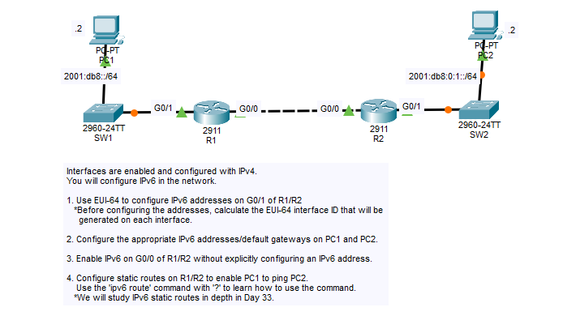

# Day 32 Lab: IPv6 Addressing (EUI-64 and Link-Local) and Static Routes

## Objective

Configure IPv6 on a small network of two routers: use EUI-64 to generate the interface IDs of the LAN-facing interfaces, configure the PCs with IPv6 addresses and default gateways, enable IPv6 on the router-to-router link without configuring an address (so only a link-local address is used), and configure IPv6 static routes so PC1 can ping PC2.

## Topology



## Networks

| Network | Link |
|---------|------|
| 2001:DB8::/64 | LAN 1: R1 G0/1 - SW1 - PC1 |
| 2001:DB8:0:1::/64 | LAN 2: R2 G0/1 - SW2 - PC2 |
| R1 G0/0 - R2 G0/0 | Router-to-router link (link-local addresses only) |

The interfaces were already enabled and configured with IPv4. This lab adds IPv6.

## Addressing Table

| Device | Interface | IPv6 Address | Notes |
|--------|-----------|--------------|-------|
| R1 | G0/1 | `2001:DB8::230:F2FF:FE36:4502/64` | Global address generated with EUI-64 |
| R1 | G0/1 | `FE80::230:F2FF:FE36:4502` | Link-local (automatic) |
| R1 | G0/0 | `FE80::230:F2FF:FE36:4501` | Link-local only, enabled with `ipv6 enable` |
| R2 | G0/0 | `FE80::201:63FF:FEB0:B801` | Link-local only, enabled with `ipv6 enable` |
| R2 | G0/1 | `2001:DB8:0:1:201:63FF:FEB0:B802/64` | Global address generated with EUI-64 |
| R2 | G0/1 | `FE80::201:63FF:FEB0:B802` | Link-local (automatic) |
| PC1 | NIC | `2001:DB8::2/64` | Default gateway: R1 G0/1 |
| PC2 | NIC | `2001:DB8:0:1::2/64` | Default gateway: R2 G0/1 |

## Steps Performed

1. **Calculate the EUI-64 interface IDs and configure G0/1 on R1 and R2**
   Worked out the interface ID that EUI-64 would generate from each interface's MAC address, then configured the IPv6 addresses with the `eui-64` option and compared the result.

2. **Configure the PCs**
   Configured the IPv6 address and default gateway on PC1 and PC2.

3. **Enable IPv6 on G0/0 of R1 and R2**
   Enabled IPv6 on the router-to-router interfaces without configuring an IPv6 address, so each uses an automatically generated link-local address.

4. **Configure IPv6 static routes**
   Configured a static route on each router to the other router's LAN so that PC1 can ping PC2.

## How EUI-64 Works

EUI-64 builds a 64-bit interface ID from the 48-bit MAC address of the interface:

1. Split the MAC address in the middle (after the first 24 bits).
2. Insert `FFFE` between the two halves.
3. Flip the 7th bit of the first byte (the universal/local bit). In hexadecimal, for a first byte of `00` this changes it to `02`.

### Calculation for this lab

| Step | R1 G0/1 | R2 G0/1 |
|------|---------|---------|
| MAC address | `0030.F236.4502` | `0001.63B0.B802` |
| Split and insert FFFE | `0030.F2FF.FE36.4502` | `0001.63FF.FEB0.B802` |
| Flip the 7th bit (`00` becomes `02`) | `0230.F2FF.FE36.4502` | `0201.63FF.FEB0.B802` |
| Interface ID | `230:F2FF:FE36:4502` | `201:63FF:FEB0:B802` |
| Global address (prefix + ID) | `2001:DB8::230:F2FF:FE36:4502` | `2001:DB8:0:1:201:63FF:FEB0:B802` |
| Link-local address | `FE80::230:F2FF:FE36:4502` | `FE80::201:63FF:FEB0:B802` |

The router-generated addresses shown by `show ipv6 interface brief` match the calculated values. Each interface has its own MAC address, so G0/0 gets a different interface ID than G0/1 (the last byte of the MAC is `01` on G0/0 and `02` on G0/1 in this lab).

## Key Commands Used

### Steps 1 and 3: Router Configuration

```
! R1
enable
configure terminal
ipv6 unicast-routing

interface g0/1
 ipv6 address 2001:db8::/64 eui-64

interface g0/0
 ipv6 enable

! R2
enable
configure terminal
ipv6 unicast-routing

interface g0/1
 ipv6 address 2001:db8:0:1::/64 eui-64

interface g0/0
 ipv6 enable
```

- `ipv6 unicast-routing` lets the router forward IPv6 packets between interfaces.
- `ipv6 address <prefix>/64 eui-64` is configured with only the prefix. The router adds the 64-bit interface ID itself.
- `ipv6 enable` turns on IPv6 on an interface without a global address. The router generates a link-local address automatically (using EUI-64 from the MAC address), which is enough for communication on the link.
- The `eui-64` address belongs on **G0/1** of each router (the LAN interface), not on G0/0.

### Step 2: PC Configuration

On each PC, open Desktop > IP Configuration and set the IPv6 configuration to static.

| PC | IPv6 Address | Prefix | IPv6 Default Gateway |
|----|--------------|--------|----------------------|
| PC1 | 2001:DB8::2 | 64 | 2001:DB8::230:F2FF:FE36:4502 |
| PC2 | 2001:DB8:0:1::2 | 64 | 2001:DB8:0:1:201:63FF:FEB0:B802 |

The default gateway can be either the router's global unicast address (the EUI-64 address, used above) or its link-local address (`FE80::230:F2FF:FE36:4502` for PC1 and `FE80::201:63FF:FEB0:B802` for PC2).

### Step 4: IPv6 Static Routes

Use `ipv6 route ?` to see how the command works. The prefix is entered as `X:X:X:X::X/<0-128>`, followed by an exit interface and/or a next-hop address.

```
! R1 - route to LAN 2 through R2's G0/0 link-local address
ipv6 route 2001:db8:0:1::/64 g0/0 FE80::201:63FF:FEB0:B801

! R2 - route to LAN 1 through R1's G0/0 link-local address
ipv6 route 2001:db8::/64 g0/0 FE80::230:F2FF:FE36:4501
```

The general format is:

```
ipv6 route <destination prefix>/<length> [exit interface] [next-hop address]
```

### Verification Commands

```
show ipv6 interface brief
show ipv6 interface g0/1
show ipv6 route
```

From PC1:

```
ping 2001:db8:0:1::2
```

## Verification

### R1: `show ipv6 interface brief`

```
GigabitEthernet0/0         [up/up]
    FE80::230:F2FF:FE36:4501
GigabitEthernet0/1         [up/up]
    FE80::230:F2FF:FE36:4502
    2001:DB8::230:F2FF:FE36:4502
GigabitEthernet0/2         [administratively down/down]
    unassigned
Vlan1                      [administratively down/down]
    unassigned
```

### R2: `show ipv6 interface brief`

```
GigabitEthernet0/0         [up/up]
    FE80::201:63FF:FEB0:B801
GigabitEthernet0/1         [up/up]
    FE80::201:63FF:FEB0:B802
    2001:DB8:0:1:201:63FF:FEB0:B802
GigabitEthernet0/2         [administratively down/down]
    unassigned
Vlan1                      [administratively down/down]
    unassigned
```

- G0/1 on each router has a link-local address and a global address with the EUI-64 interface ID.
- G0/0 on each router has only a link-local address, because no IPv6 address was configured on it.
- After the static routes are added, `show ipv6 route` on R1 lists an `S` route to `2001:DB8:0:1::/64` through G0/0, and R2 has the matching `S` route to `2001:DB8::/64`.
- PC1 can ping PC2. The first ping may time out while the devices use Neighbor Discovery to find each other's MAC addresses.

## Why the Link-Local Address Is Enough on G0/0

The G0/0 interfaces only need to talk to each other over a single link. A link-local address is valid on that link, is generated automatically, and does not use up any global address space. Routers can use a neighbor's link-local address as the next hop for a static route.

## Why the Exit Interface Is Required

A link-local address is only unique on one link, so the same `FE80::` address could exist on several interfaces of the same router. When the next hop is a link-local address, the route must also state the **exit interface** so the router knows which link to send the packet out of. This is why the routes above use both `g0/0` and the link-local next hop (a fully specified static route).

## Skills Demonstrated

- Calculating an EUI-64 interface ID from a MAC address
- Configuring IPv6 addresses with `eui-64`
- Enabling IPv6 on an interface without a global address (`ipv6 enable`) and using link-local addresses
- Configuring IPv6 default gateways on hosts
- Configuring IPv6 static routes with a link-local next hop and an exit interface
- Verification with `show ipv6 interface brief`, `show ipv6 route`, and `ping`
