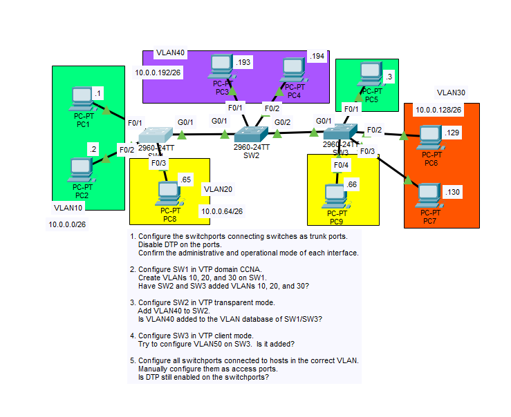

# Lab: Trunking, DTP and VTP

## Objective

Configure trunk links between three switches with DTP disabled, use VTP (server, transparent, and client modes) to distribute VLANs, observe how each VTP mode behaves when VLANs are created, and configure host-facing ports as static access ports.

## Topology



## Subnet and VLAN Breakdown

There is no router in this topology, so each VLAN is a separate Layer 2 network. All subnets use `/26` (`255.255.255.192`).

| VLAN | Network | Usable Host Range | Broadcast |
|------|---------|-------------------|-----------|
| 10 | 10.0.0.0/26 | 10.0.0.1 - 10.0.0.62 | 10.0.0.63 |
| 20 | 10.0.0.64/26 | 10.0.0.65 - 10.0.0.126 | 10.0.0.127 |
| 30 | 10.0.0.128/26 | 10.0.0.129 - 10.0.0.190 | 10.0.0.191 |
| 40 | 10.0.0.192/26 | 10.0.0.193 - 10.0.0.254 | 10.0.0.255 |

## Port and VLAN Assignment

| Device | Port | Connected To | VLAN / Mode |
|--------|------|--------------|-------------|
| SW1 | F0/1 | PC1 | VLAN 10 (access) |
| SW1 | F0/2 | PC2 | VLAN 10 (access) |
| SW1 | F0/3 | PC8 | VLAN 20 (access) |
| SW1 | G0/1 | SW2 G0/1 | Trunk |
| SW2 | G0/1 | SW1 G0/1 | Trunk |
| SW2 | G0/2 | SW3 G0/1 | Trunk |
| SW2 | F0/1 | PC3 | VLAN 40 (access) |
| SW2 | F0/2 | PC4 | VLAN 40 (access) |
| SW3 | G0/1 | SW2 G0/2 | Trunk |
| SW3 | F0/1 | PC5 | VLAN 10 (access) |
| SW3 | F0/2 | PC6 | VLAN 30 (access) |
| SW3 | F0/3 | PC7 | VLAN 30 (access) |
| SW3 | F0/4 | PC9 | VLAN 20 (access) |

## IP Addressing Table

| Device | VLAN | IP Address | Subnet Mask |
|--------|------|------------|-------------|
| PC1 | 10 | 10.0.0.1 | 255.255.255.192 |
| PC2 | 10 | 10.0.0.2 | 255.255.255.192 |
| PC5 | 10 | 10.0.0.3 | 255.255.255.192 |
| PC8 | 20 | 10.0.0.65 | 255.255.255.192 |
| PC9 | 20 | 10.0.0.66 | 255.255.255.192 |
| PC6 | 30 | 10.0.0.129 | 255.255.255.192 |
| PC7 | 30 | 10.0.0.130 | 255.255.255.192 |
| PC3 | 40 | 10.0.0.193 | 255.255.255.192 |
| PC4 | 40 | 10.0.0.194 | 255.255.255.192 |

No default gateway is needed because there is no router in this lab, so hosts can only communicate within their own VLAN.

## Steps Performed

1. **Configure the trunk ports and disable DTP**
   Set the switch-to-switch ports (SW1 G0/1, SW2 G0/1 and G0/2, SW3 G0/1) to trunk mode and disabled DTP with `switchport nonegotiate`. Confirmed the administrative and operational mode of each interface.

2. **Configure SW1 as the VTP server**
   Set SW1 to VTP domain `CCNA` and created VLANs 10, 20, and 30.

3. **Configure SW2 as VTP transparent**
   Set SW2 to VTP transparent mode and created VLAN 40 locally.

4. **Configure SW3 as a VTP client**
   Set SW3 to VTP client mode and tried to create VLAN 50 to test client restrictions.

5. **Configure the host-facing ports**
   Manually configured all host-facing ports as access ports in their correct VLANs, then checked whether DTP was still active on them.

## Key Commands Used

### Trunk Ports (all switches)

```
! SW1
interface g0/1
 switchport mode trunk
 switchport nonegotiate

! SW2
interface range g0/1 - 2
 switchport mode trunk
 switchport nonegotiate

! SW3
interface g0/1
 switchport mode trunk
 switchport nonegotiate
```

Verify the administrative and operational mode:

```
show interfaces trunk
show interfaces g0/1 switchport
```

### SW1 - VTP Server

```
configure terminal
hostname SW1
vtp mode server
vtp domain CCNA

vlan 10
vlan 20
vlan 30
end
```

### SW2 - VTP Transparent

```
configure terminal
hostname SW2
vtp mode transparent

vlan 40
end
```

### SW3 - VTP Client

```
configure terminal
hostname SW3
vtp mode client

vlan 50
```

### Access Ports

```
! SW1
interface range f0/1 - 2
 switchport mode access
 switchport access vlan 10
interface f0/3
 switchport mode access
 switchport access vlan 20

! SW2
interface range f0/1 - 2
 switchport mode access
 switchport access vlan 40

! SW3
interface f0/1
 switchport mode access
 switchport access vlan 10
interface range f0/2 - 3
 switchport mode access
 switchport access vlan 30
interface f0/4
 switchport mode access
 switchport access vlan 20
```

## Verification and Observations

Useful commands: `show vtp status`, `show vlan brief`, `show interfaces trunk`, `show interfaces <int> switchport`.

### 1. Trunk ports and DTP


- Every switch-to-switch interface shows administrative mode **trunk** and operational mode **trunk**.
- `switchport nonegotiate` stops the ports from sending DTP frames, so the trunks come up because they are configured statically, not negotiated.

### 2. Did SW2 and SW3 receive VLANs 10, 20, and 30?


- **Yes.** After SW1 was placed in domain `CCNA` and VLANs were created, SW2 and SW3 received VLANs 10, 20, and 30.
- SW2 and SW3 start in the default VTP server mode with no domain, so they join the `CCNA` domain from SW1's advertisements and synchronize their VLAN databases. The VTP revision number on SW1, SW2, and SW3 increased to match.

### 3. Is VLAN 40 (created on SW2) added to SW1 and SW3?

- **No.** A VTP transparent switch keeps its own VLANs locally and does not advertise them. VLAN 40 exists only on SW2.
- SW2 still forwards VTP advertisements between SW1 and SW3, and it kept VLANs 10, 20, and 30 that it learned before it was switched to transparent mode.

### 4. Can VLAN 50 be created on SW3 (VTP client)?

- **No.** A VTP client cannot create, modify, or delete VLANs, and the switch rejects the command with an error saying VLAN configuration is not allowed in client mode. VLAN 50 is not added.
- A client only learns VLANs from the VTP server.

### 5. Is DTP still enabled on the access ports?


- **No.** Once a port is manually set with `switchport mode access`, DTP negotiation is turned off. `show interfaces <int> switchport` shows `Negotiation of Trunking: Off` for these ports.

## Summary of VTP Modes

| Mode | Create / Edit VLANs | Advertises Own VLANs | Syncs From Advertisements | Forwards Advertisements |
|------|---------------------|----------------------|---------------------------|-------------------------|
| Server | Yes | Yes | Yes | Yes |
| Client | No | No | Yes | Yes |
| Transparent | Yes (local only) | No | No | Yes |

## Skills Demonstrated

- Configuring static trunk ports and disabling DTP
- Verifying administrative and operational interface modes
- Configuring VTP server, client, and transparent modes
- Understanding how VLANs are (and are not) propagated by VTP
- Assigning host ports to VLANs as static access ports
- Verification with `show vtp status`, `show vlan brief`, `show interfaces trunk`, and `show interfaces switchport`
