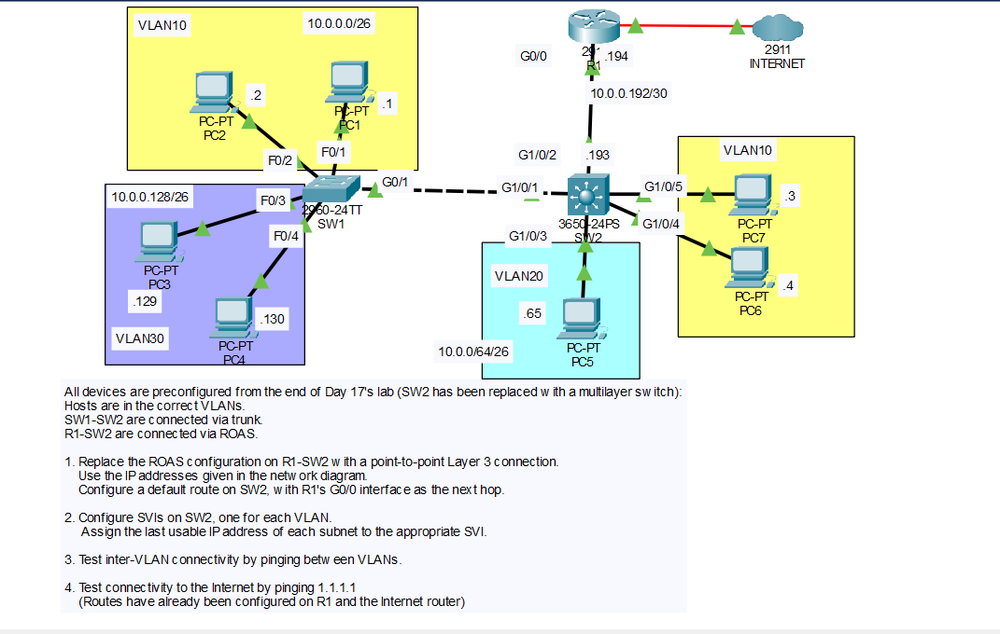

# Day 19 Lab: Multilayer Switch, SVIs and Routed Ports

## Objective

Replace the router-on-a-stick (ROAS) setup between R1 and SW2 with a point-to-point Layer 3 connection, configure SW2 (a 3650-24PS multilayer switch) to perform inter-VLAN routing using SVIs, add a default route on SW2 pointing to R1, and verify connectivity between VLANs and to the Internet.

## Starting Point

All devices were preconfigured from the end of Day 17's lab, with SW2 replaced by a multilayer switch:

- Hosts are in the correct VLANs.
- SW1 and SW2 are connected via a trunk.
- R1 and SW2 were connected via ROAS (this is what gets replaced).

## Topology



## Subnet Breakdown

| Network | Purpose | Network Address | First Usable | Last Usable (Gateway / SVI) | Broadcast |
|---------|---------|-----------------|--------------|-----------------------------|-----------|
| VLAN 10 | Hosts | 10.0.0.0/26 | 10.0.0.1 | 10.0.0.62 | 10.0.0.63 |
| VLAN 20 | Hosts | 10.0.0.64/26 | 10.0.0.65 | 10.0.0.126 | 10.0.0.127 |
| VLAN 30 | Hosts | 10.0.0.128/26 | 10.0.0.129 | 10.0.0.190 | 10.0.0.191 |
| R1-SW2 link | Point-to-point | 10.0.0.192/30 | 10.0.0.193 | 10.0.0.194 | 10.0.0.195 |

The VLAN subnets use `255.255.255.192` (/26). The R1-SW2 link uses `255.255.255.252` (/30), which provides exactly two usable addresses: `.193` for SW2 and `.194` for R1.

## IP Addressing Table

| Device | Interface | IP Address | Subnet Mask | Default Gateway |
|--------|-----------|------------|-------------|-----------------|
| R1 | G0/0 | 10.0.0.194 | 255.255.255.252 | N/A |
| SW2 | G1/0/2 (routed port) | 10.0.0.193 | 255.255.255.252 | N/A |
| SW2 | VLAN 10 SVI | 10.0.0.62 | 255.255.255.192 | N/A |
| SW2 | VLAN 20 SVI | 10.0.0.126 | 255.255.255.192 | N/A |
| SW2 | VLAN 30 SVI | 10.0.0.190 | 255.255.255.192 | N/A |
| PC1 | NIC | 10.0.0.1 | 255.255.255.192 | 10.0.0.62 |
| PC2 | NIC | 10.0.0.2 | 255.255.255.192 | 10.0.0.62 |
| PC7 | NIC | 10.0.0.3 | 255.255.255.192 | 10.0.0.62 |
| PC6 | NIC | 10.0.0.4 | 255.255.255.192 | 10.0.0.62 |
| PC5 | NIC | 10.0.0.65 | 255.255.255.192 | 10.0.0.126 |
| PC3 | NIC | 10.0.0.129 | 255.255.255.192 | 10.0.0.190 |
| PC4 | NIC | 10.0.0.130 | 255.255.255.192 | 10.0.0.190 |

The default gateway for each PC is the last usable address of its subnet, which is now the matching SVI on SW2 instead of an R1 subinterface.

## Steps Performed

1. **Remove the ROAS configuration from R1**
   Deleted the subinterfaces (G0/0.10, G0/0.20, G0/0.30) from R1's G0/0 interface, since R1 no longer routes between VLANs.

2. **Configure the Layer 3 link on R1**
   Assigned `10.0.0.194/30` directly to R1's G0/0 interface and enabled it.

3. **Configure the routed port on SW2**
   Enabled IP routing on SW2, then changed G1/0/2 from a switchport (trunk) to a routed port using `no switchport` and assigned `10.0.0.193/30`.

4. **Configure the default route on SW2**
   Added a default route on SW2 with R1's G0/0 address (`10.0.0.194`) as the next hop so traffic to unknown networks (such as the Internet) is sent to R1.

5. **Configure SVIs on SW2**
   Created one SVI per VLAN (VLAN 10, 20, and 30) and assigned the last usable address of each subnet. These addresses match the default gateways already configured on the PCs.

6. **Test inter-VLAN connectivity**
   Pinged between PCs in different VLANs to confirm SW2 routes between them.

7. **Test Internet connectivity**
   Pinged `1.1.1.1` from the PCs to confirm traffic is routed from SW2 to R1 and on to the Internet router. The routes on R1 and the Internet router were already configured.

## Key Commands Used

### R1 Configuration

```
enable
configure terminal

no interface g0/0.10
no interface g0/0.20
no interface g0/0.30

interface g0/0
 description Link to SW2 G1/0/2
 ip address 10.0.0.194 255.255.255.252
 no shutdown

end
copy running-config startup-config
```

### SW2 Configuration

```
enable
configure terminal

ip routing

interface g1/0/2
 description Link to R1 G0/0
 no switchport
 ip address 10.0.0.193 255.255.255.252
 no shutdown

ip route 0.0.0.0 0.0.0.0 10.0.0.194

interface vlan 10
 description Gateway for VLAN 10
 ip address 10.0.0.62 255.255.255.192
 no shutdown

interface vlan 20
 description Gateway for VLAN 20
 ip address 10.0.0.126 255.255.255.192
 no shutdown

interface vlan 30
 description Gateway for VLAN 30
 ip address 10.0.0.190 255.255.255.192
 no shutdown

end
copy running-config startup-config
```

> `ip routing` is required. Without it, the multilayer switch acts as a Layer 2 switch only and will not route between SVIs or use the default route.

## Verification

### SW2: `show ip interface brief`

- G1/0/2 is up/up with `10.0.0.193`.
- VLAN 10, VLAN 20, and VLAN 30 SVIs are up/up with `10.0.0.62`, `10.0.0.126`, and `10.0.0.190`.

### SW2: `show ip route`

- The three VLAN subnets and the `10.0.0.192/30` link appear as connected routes.
- A static default route (`S*`) points to `10.0.0.194`.

### R1: `show ip interface brief`


- G0/0 is up/up with `10.0.0.194` and the old subinterfaces are gone.

### Connectivity Tests

| Test | Source | Destination | Type |
|------|--------|-------------|------|
| 1 | PC1 | PC2 | Same VLAN, same switch |
| 2 | PC1 | PC7 | Same VLAN, across the SW1-SW2 trunk |
| 3 | PC1 | PC5 | Inter-VLAN (10 to 20), routed by SW2 |
| 4 | PC1 | PC3 | Inter-VLAN (10 to 30), routed by SW2 |
| 5 | PC4 | PC6 | Inter-VLAN (30 to 10), routed by SW2 |
| 6 | Any PC | 1.1.1.1 | Internet, via SW2 default route and R1 |

All pings were successful, confirming that SW2 routes between the VLANs using its SVIs and forwards Internet-bound traffic to R1 using the default route.

## Skills Demonstrated

- Replacing router-on-a-stick with a Layer 3 routed port
- Subnetting a /30 point-to-point link
- Enabling routing on a multilayer switch (`ip routing`)
- Configuring SVIs for inter-VLAN routing
- Configuring a static default route
- Verification with `show ip interface brief` and `show ip route`
- End-to-end and Internet connectivity testing with ping
