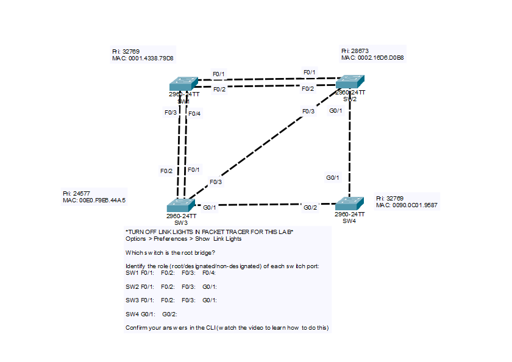

# Day 20: Spanning Tree Protocol (STP) - Root Bridge and Port Roles

## Objective

Using the bridge priorities and MAC addresses shown in the topology, determine which switch is the root bridge, identify the role (root, designated, or non-designated) of every switch port, and confirm the answers in the CLI with `show spanning-tree`.

## Topology




## Bridge Information

| Switch | Priority | MAC Address | Notes |
|--------|----------|-------------|-------|
| SW1 | 32769 | 0001.4338.79D8 | Default priority (32768 + VLAN 1) |
| SW2 | 28673 | 0002.16D6.D0B8 | 28672 + VLAN 1 |
| SW3 | 24577 | 00E0.F9E8.44A5 | 24576 + VLAN 1 |
| SW4 | 32769 | 0090.0C01.9587 | Default priority (32768 + VLAN 1) |

The displayed priority is the configured priority plus the VLAN ID (the extended system ID), which is why the values end in `1` for VLAN 1.

## Links

| Link | Switch A Port | Switch B Port | Speed | STP Port Cost |
|------|---------------|---------------|-------|---------------|
| 1 | SW1 F0/1 | SW2 F0/1 | FastEthernet | 19 |
| 2 | SW1 F0/2 | SW2 F0/2 | FastEthernet | 19 |
| 3 | SW1 F0/3 | SW3 F0/2 | FastEthernet | 19 |
| 4 | SW1 F0/4 | SW3 F0/1 | FastEthernet | 19 |
| 5 | SW2 F0/3 | SW3 F0/3 | FastEthernet | 19 |
| 6 | SW2 G0/1 | SW4 G0/1 | GigabitEthernet | 4 |
| 7 | SW3 G0/1 | SW4 G0/2 | GigabitEthernet | 4 |

## Steps Performed

1. **Turn off link lights in Packet Tracer**
   Disabled the link lights (Options > Preferences > Show Link Lights) so the port states are not given away in the topology and must be determined by analysis.

2. **Determine the root bridge**
   Compared the bridge IDs. The switch with the lowest priority becomes the root bridge. The MAC address is only used as a tie-breaker when priorities are equal.

3. **Determine the root port on each non-root switch**
   Each non-root switch picks one root port: the port with the lowest total path cost to the root bridge.

4. **Determine the designated port on each segment**
   On each link, the port belonging to the switch with the lowest root path cost is the designated port. If the costs tie, the lowest bridge ID wins.

5. **Assign non-designated ports**
   Any port that is neither a root port nor a designated port is non-designated and is blocked.

6. **Confirm in the CLI**
   Ran `show spanning-tree` on each switch to check the root bridge and the role and state of every port.

## Analysis

### Root Bridge

**SW3** is the root bridge. Its priority (24577) is the lowest of the four switches. All of SW3's ports are designated ports.

### Root Path Costs

| Switch | Root Port | Path | Root Path Cost |
|--------|-----------|------|----------------|
| SW1 | F0/4 | Direct to SW3 | 19 |
| SW2 | G0/1 | SW2 -> SW4 -> SW3 (4 + 4) | 8 |
| SW4 | G0/2 | Direct to SW3 | 4 |

### Why These Root Ports

- **SW4:** G0/2 goes straight to SW3 with a cost of 4, which is lower than any other path.
- **SW2:** The direct path through F0/3 costs 19, but going through SW4 over two Gigabit links costs 4 + 4 = 8, so **G0/1** is the root port. A lower-cost path through more hops beats a direct FastEthernet link.
- **SW1:** F0/3 and F0/4 both connect directly to SW3 with a cost of 19. Because the cost, the sender bridge ID (SW3), and the port priority are all equal, the tie is broken by the lowest sender port ID. F0/4 connects to SW3 F0/1, which is lower than SW3 F0/2, so **F0/4** is the root port.

### Why These Designated and Non-Designated Ports

- **SW1 F0/1 and F0/2 vs SW2 F0/1 and F0/2:** SW2's root path cost (8) is lower than SW1's (19), so SW2's ports are designated and SW1's ports are non-designated.
- **SW1 F0/3:** Not the root port, and the other end (SW3 F0/2) is a designated port on the root bridge, so SW1 F0/3 is non-designated.
- **SW2 F0/3:** Not the root port, and the other end (SW3 F0/3) is a designated port on the root bridge, so SW2 F0/3 is non-designated.
- **SW4 G0/1 vs SW2 G0/1:** SW4's root path cost (4) is lower than SW2's (8), so SW4 G0/1 is designated and SW2 G0/1 is the root port.

## Port Roles

| Switch | Port | Role | State |
|--------|------|------|-------|
| SW1 | F0/1 | Non-designated | Blocking |
| SW1 | F0/2 | Non-designated | Blocking |
| SW1 | F0/3 | Non-designated | Blocking |
| SW1 | F0/4 | Root | Forwarding |
| SW2 | F0/1 | Designated | Forwarding |
| SW2 | F0/2 | Designated | Forwarding |
| SW2 | F0/3 | Non-designated | Blocking |
| SW2 | G0/1 | Root | Forwarding |
| SW3 | F0/1 | Designated | Forwarding |
| SW3 | F0/2 | Designated | Forwarding |
| SW3 | F0/3 | Designated | Forwarding |
| SW3 | G0/1 | Designated | Forwarding |
| SW4 | G0/1 | Designated | Forwarding |
| SW4 | G0/2 | Root | Forwarding |

Four ports are blocking (SW1 F0/1, F0/2, F0/3 and SW2 F0/3), which removes every Layer 2 loop in the topology.

## Key Commands Used

```
show spanning-tree
show spanning-tree vlan 1
show spanning-tree summary
```

On each switch, check these fields in the output:

- **Root ID** section: shows the root bridge's priority and MAC address. On SW3 it also says "This bridge is the root".
- **Bridge ID** section: shows the local switch's priority and MAC address.
- **Interface table**: shows each port's role (`Root`, `Desg`, `Altn`), state (`FWD`, `BLK`), and cost.

## Verification

### SW3 (Root Bridge)


- Reports that the bridge is the root, and all ports are `Desg` / `FWD`.

### SW1


- F0/4 is `Root` / `FWD`; F0/1, F0/2, and F0/3 are `Altn` / `BLK`.

### SW2


- G0/1 is `Root` / `FWD` with a root path cost of 8; F0/1 and F0/2 are `Desg` / `FWD`; F0/3 is `Altn` / `BLK`.

### SW4


- G0/2 is `Root` / `FWD`; G0/1 is `Desg` / `FWD`.

## Skills Demonstrated

- Determining the root bridge from bridge priority and MAC address
- Calculating root path costs using STP port costs (FastEthernet 19, GigabitEthernet 4)
- Identifying root, designated, and non-designated port roles
- Applying STP tie-breakers (lowest cost, lowest bridge ID, lowest sender port ID)
- Verifying STP operation with `show spanning-tree`
