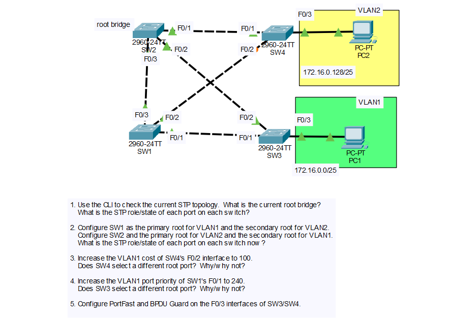

# Day 21 Lab: Configuring STP (PVST+)

## Objective

Examine the default spanning tree topology of four switches running PVST+, manipulate the root bridge election per VLAN, change port cost and port priority to see how they affect root port selection, and protect host-facing ports with PortFast and BPDU Guard.

## Topology



## VLANs and Networks

| VLAN | Network | Host | Connected To |
|------|---------|------|--------------|
| VLAN 1 | 172.16.0.0/25 | PC1 | SW3 F0/3 |
| VLAN 2 | 172.16.0.128/25 | PC2 | SW4 F0/3 |

PVST+ runs a **separate spanning tree instance for each VLAN**, so VLAN 1 and VLAN 2 can have different root bridges and different blocked ports.

## Links

| Link | Switch A Port | Switch B Port | Speed | STP Port Cost |
|------|---------------|---------------|-------|---------------|
| 1 | SW2 F0/1 | SW4 F0/1 | FastEthernet | 19 |
| 2 | SW2 F0/2 | SW3 F0/2 | FastEthernet | 19 |
| 3 | SW2 F0/3 | SW1 F0/3 | FastEthernet | 19 |
| 4 | SW1 F0/2 | SW4 F0/2 | FastEthernet | 19 |
| 5 | SW1 F0/1 | SW3 F0/1 | FastEthernet | 19 |
| 6 | SW3 F0/3 | PC1 | FastEthernet | N/A (host port) |
| 7 | SW4 F0/3 | PC2 | FastEthernet | N/A (host port) |

The switch-to-switch links are assumed to be preconfigured trunks that carry VLANs 1 and 2.

## Steps Performed

1. **Check the current STP topology**
   Ran `show spanning-tree` on all four switches to find the root bridge and the role and state of every port.

2. **Configure the root bridges per VLAN**
   Made SW1 the primary root for VLAN 1 and the secondary root for VLAN 2. Made SW2 the primary root for VLAN 2 and the secondary root for VLAN 1. Re-checked the role and state of every port.

3. **Change the VLAN 1 port cost on SW4 F0/2**
   Set the VLAN 1 cost of SW4 F0/2 to 100 and checked whether SW4 chose a different root port.

4. **Change the VLAN 1 port priority on SW1 F0/1**
   Set the VLAN 1 port priority of SW1 F0/1 to 240 and checked whether SW3 chose a different root port.

5. **Configure PortFast and BPDU Guard**
   Enabled PortFast and BPDU Guard on the host-facing F0/3 interfaces of SW3 and SW4.

## Key Commands Used

### Verification

```
show spanning-tree
show spanning-tree vlan 1
show spanning-tree vlan 2
show spanning-tree summary
```

### Step 2: Root Bridge Configuration

```
! SW1
configure terminal
spanning-tree vlan 1 root primary
spanning-tree vlan 2 root secondary

! SW2
configure terminal
spanning-tree vlan 2 root primary
spanning-tree vlan 1 root secondary
```

The `root primary` macro lowers the priority to 24576 (or lower, if needed to beat the current root). The `root secondary` macro sets the priority to 28672. Fixed values can also be set with `spanning-tree vlan <id> priority <value>`.

### Step 3: Port Cost

```
! SW4
interface f0/2
 spanning-tree vlan 1 cost 100
```

### Step 4: Port Priority

```
! SW1
interface f0/1
 spanning-tree vlan 1 port-priority 240
```

### Step 5: PortFast and BPDU Guard

```
! SW3
interface f0/3
 spanning-tree portfast
 spanning-tree bpduguard enable

! SW4
interface f0/3
 spanning-tree portfast
 spanning-tree bpduguard enable
```

## Step 1: Initial STP Topology


**Root bridge:** SW2. All switches use the default priority, so the switch with the lowest MAC address wins the election, and SW2 is the root for both VLAN 1 and VLAN 2.

All links are FastEthernet, so every link costs 19.

| Switch | Port | Role | State | Reason |
|--------|------|------|-------|--------|
| SW2 | F0/1, F0/2, F0/3 | Designated | Forwarding | Root bridge, so all ports are designated |
| SW1 | F0/3 | Root | Forwarding | Direct link to the root (cost 19) |
| SW3 | F0/2 | Root | Forwarding | Direct link to the root (cost 19) |
| SW4 | F0/1 | Root | Forwarding | Direct link to the root (cost 19) |
| SW1 / SW4 | F0/2 | Designated / Non-designated | Forwarding / Blocking | Both switches have a root path cost of 19, so the **lower bridge ID (MAC)** wins the designated role |
| SW1 / SW3 | F0/1 | Designated / Non-designated | Forwarding / Blocking | Both switches have a root path cost of 19, so the **lower bridge ID (MAC)** wins the designated role |
| SW3 | F0/3 | Designated | Forwarding | Host port (VLAN 1) |
| SW4 | F0/3 | Designated | Forwarding | Host port (VLAN 2) |

The two tie-break links (SW1-SW4 on F0/2 and SW1-SW3 on F0/1) depend on the MAC addresses of the switches. The switch with the lower MAC is designated on each link and the other end is blocked (alternate).

## Step 2: After Configuring the Root Bridges


| VLAN | Root Bridge | Priority | Secondary Root | Priority |
|------|-------------|----------|----------------|----------|
| VLAN 1 | SW1 | 24577 | SW2 | 28673 |
| VLAN 2 | SW2 | 24578 | SW1 | 28674 |

The displayed priority is the configured priority plus the VLAN ID.

### VLAN 1 (Root: SW1)

| Switch | Port | Role | State |
|--------|------|------|-------|
| SW1 | F0/1 | Designated | Forwarding |
| SW1 | F0/2 | Designated | Forwarding |
| SW1 | F0/3 | Designated | Forwarding |
| SW2 | F0/1 | Designated | Forwarding |
| SW2 | F0/2 | Designated | Forwarding |
| SW2 | F0/3 | Root | Forwarding |
| SW3 | F0/1 | Root | Forwarding |
| SW3 | F0/2 | Non-designated | Blocking |
| SW3 | F0/3 | Designated | Forwarding |
| SW4 | F0/1 | Non-designated | Blocking |
| SW4 | F0/2 | Root | Forwarding |

- SW2, SW3, and SW4 each have a direct 19-cost link to SW1, so those links become their root ports.
- On the SW2-SW4 and SW2-SW3 links, both ends have a root path cost of 19. SW2 has the lower bridge ID (28673, as the secondary root), so SW2's ports are designated and SW4 F0/1 and SW3 F0/2 are blocked.
- SW4 F0/3 connects to PC2 in VLAN 2, so it does not take part in the VLAN 1 spanning tree.

### VLAN 2 (Root: SW2)

| Switch | Port | Role | State |
|--------|------|------|-------|
| SW2 | F0/1 | Designated | Forwarding |
| SW2 | F0/2 | Designated | Forwarding |
| SW2 | F0/3 | Designated | Forwarding |
| SW1 | F0/1 | Designated | Forwarding |
| SW1 | F0/2 | Designated | Forwarding |
| SW1 | F0/3 | Root | Forwarding |
| SW3 | F0/1 | Non-designated | Blocking |
| SW3 | F0/2 | Root | Forwarding |
| SW4 | F0/1 | Root | Forwarding |
| SW4 | F0/2 | Non-designated | Blocking |
| SW4 | F0/3 | Designated | Forwarding |

- SW1, SW3, and SW4 each have a direct 19-cost link to SW2, so those links become their root ports.
- On the SW1-SW3 and SW1-SW4 links, both ends have a root path cost of 19. SW1 has the lower bridge ID (28674, as the secondary root), so SW1's ports are designated and SW3 F0/1 and SW4 F0/2 are blocked.
- SW3 F0/3 connects to PC1 in VLAN 1, so it does not take part in the VLAN 2 spanning tree.

Because the two VLANs block different ports, traffic for each VLAN takes a different path through the network.

## Step 3: Increase the VLAN 1 Cost of SW4 F0/2 to 100


**Does SW4 select a different root port? Yes.**

- Before the change, SW4's VLAN 1 root port was F0/2 (direct link to the root, SW1) with a root path cost of 19.
- After the change, the path through F0/2 costs 100. The path through F0/1 (SW4 -> SW2 -> SW1) costs 19 + 19 = 38.
- 38 is lower than 100, so SW4 selects **F0/1** as its new root port. F0/2 becomes non-designated (blocking), because SW1 is the root and its end of the link is the designated port.

## Step 4: Increase the VLAN 1 Port Priority of SW1 F0/1 to 240


**Does SW3 select a different root port? No.**

- SW3's root port for VLAN 1 is F0/1 (direct link to the root, SW1) with a root path cost of 19. The alternative through F0/2 costs 19 + 19 = 38.
- Port priority is only used as the **last tie-breaker**, after root path cost, sender bridge ID, and others. It matters when a switch has two equal-cost paths to the same neighbor (for example, two parallel links).
- SW3's paths have different costs, so the cost decides and the port priority change has no effect.

## Step 5: PortFast and BPDU Guard


- **PortFast** moves the port straight to forwarding without waiting through the listening and learning states, so the PC gets network access immediately.
- **BPDU Guard** puts the port into the err-disabled state if a BPDU is received. This protects the topology if someone connects a switch to a host-facing port.

Verify with:

```
show running-config interface f0/3
show spanning-tree interface f0/3 portfast
show spanning-tree interface f0/3 detail
```

## Skills Demonstrated

- Reading `show spanning-tree` output to identify the root bridge and port roles and states
- Applying the STP election rules: lowest root path cost, lowest bridge ID, and lowest port ID
- Configuring per-VLAN root bridges with PVST+
- Using port cost and port priority to influence STP decisions
- Configuring PortFast and BPDU Guard on edge ports
