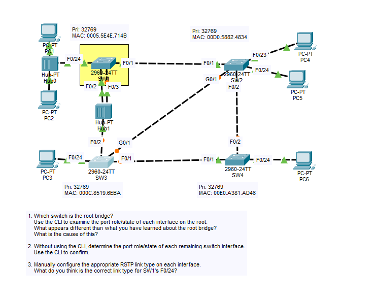

# Day 22 Lab: Rapid PVST+ (RSTP) - Root Bridge, Port Roles and Link Types

## Objective

Identify the root bridge in a topology that includes hubs, work out the Rapid Spanning Tree Protocol (RSTP) role and state of every switch port, confirm the results in the CLI, and manually configure the correct RSTP link type on each interface.

## Topology



## Bridge Information

| Switch | Priority | MAC Address |
|--------|----------|-------------|
| SW1 | 32769 | 0005.5E4E.714B |
| SW2 | 32769 | 00D0.5882.4834 |
| SW3 | 32769 | 000C.8519.6EBA |
| SW4 | 32769 | 00E0.A381.AD46 |

All switches use the default priority (32768 + VLAN 1), so the root bridge is decided by the lowest MAC address.

## Links

| Link | Switch A Port | Switch B / Device Port | Speed | STP Port Cost |
|------|---------------|------------------------|-------|---------------|
| 1 | SW1 F0/1 | SW2 F0/1 | FastEthernet | 19 |
| 2 | SW1 F0/2 | Hub1 | FastEthernet | 19 |
| 3 | SW1 F0/3 | Hub1 | FastEthernet | 19 |
| 4 | SW3 F0/2 | Hub1 | FastEthernet | 19 |
| 5 | SW2 G0/1 | SW3 G0/1 | GigabitEthernet | 4 |
| 6 | SW2 F0/2 | SW4 F0/2 | FastEthernet | 19 |
| 7 | SW3 F0/1 | SW4 F0/1 | FastEthernet | 19 |
| 8 | SW1 F0/24 | Hub0 (PC1, PC2) | FastEthernet | 19 |
| 9 | SW2 F0/23 | PC4 | FastEthernet | 19 |
| 10 | SW2 F0/24 | PC5 | FastEthernet | 19 |
| 11 | SW3 F0/24 | PC3 | FastEthernet | 19 |
| 12 | SW4 F0/24 | PC6 | FastEthernet | 19 |

Hub0 connects PC1 and PC2 to SW1. Hub1 connects SW1 F0/2, SW1 F0/3, and SW3 F0/2 together, so these three ports share one segment.

## Steps Performed

1. **Find the root bridge and inspect its ports**
   Compared the bridge IDs, then used the CLI to check the role and state of each interface on the root switch and noted anything that differed from normal root bridge behavior.

2. **Determine the remaining port roles without the CLI**
   Calculated the root port, designated ports, and alternate ports on the other switches from the root path costs and bridge IDs, then confirmed the answers with `show spanning-tree`.

3. **Configure the RSTP link types**
   Manually set the link type on each interface: `point-to-point` or `shared`.

## Key Commands Used

### Verification

```
show spanning-tree
show spanning-tree interface f0/24 detail
```

### Enable Rapid PVST+ (if not already enabled on all switches)

```
configure terminal
spanning-tree mode rapid-pvst
```

### Link Type Configuration

```
! SW1
interface range f0/2 - 3
 spanning-tree link-type shared
interface f0/24
 spanning-tree link-type shared
interface f0/1
 spanning-tree link-type point-to-point

! SW2
interface range f0/1 - 2
 spanning-tree link-type point-to-point
interface g0/1
 spanning-tree link-type point-to-point
interface range f0/23 - 24
 spanning-tree link-type point-to-point

! SW3
interface f0/2
 spanning-tree link-type shared
interface range f0/1 , g0/1
 spanning-tree link-type point-to-point
interface f0/24
 spanning-tree link-type point-to-point

! SW4
interface range f0/1 - 2
 spanning-tree link-type point-to-point
interface f0/24
 spanning-tree link-type point-to-point
```

## Step 1: Root Bridge


**The root bridge is SW1.** All four switches have the same priority, so the lowest MAC address wins, and SW1 (`0005.5E4E.714B`) has the lowest.

### What appears different on the root bridge?

On a root bridge, all ports are normally **designated ports in the forwarding state**. On SW1 this is not the case:

| Port | Role | State |
|------|------|-------|
| F0/1 | Designated | Forwarding |
| F0/2 | Designated | Forwarding |
| F0/3 | **Backup** | **Discarding (blocking)** |
| F0/24 | Designated | Forwarding |

### Cause

SW1's F0/2 and F0/3 are both connected to **Hub1**, so they are on the same shared segment. A hub repeats every frame out all of its ports, so F0/3 receives the BPDUs that SW1 itself sends out of F0/2.

When a switch receives its own BPDUs on another port, it has two ports on the same segment. RSTP keeps the port with the lower port ID (F0/2, port ID 128.2) as the designated port and puts the other port (F0/3, port ID 128.3) in the **backup** role in the discarding state. This prevents a loop through the hub.

## Step 2: Port Roles on the Remaining Switches


### Root Path Costs

| Switch | Root Port | Path | Root Path Cost |
|--------|-----------|------|----------------|
| SW2 | F0/1 | Direct to SW1 | 19 |
| SW3 | F0/2 | Direct to SW1 (through Hub1) | 19 |
| SW4 | F0/1 | SW4 -> SW3 -> SW1 | 38 |

- **SW2:** The direct link (19) beats the path through SW3 over G0/1 (4 + 19 = 23), so F0/1 is the root port.
- **SW3:** The direct link through Hub1 (19) beats the path through SW2 over G0/1 (4 + 19 = 23), so F0/2 is the root port.
- **SW4:** Going through SW2 (via F0/2) and through SW3 (via F0/1) both cost 38. The tie is broken by the lowest sender bridge ID: SW3 (`000C.8519.6EBA`) is lower than SW2 (`00D0.5882.4834`), so **F0/1** is the root port.

### Designated and Alternate Ports

- **SW2 G0/1 and SW3 G0/1:** Both switches have a root path cost of 19, so the lower bridge ID wins. SW3 has the lower MAC, so SW3 G0/1 is designated and **SW2 G0/1 is alternate**.
- **SW2 F0/2 and SW4 F0/2:** SW2's root path cost (19) is lower than SW4's (38), so SW2 F0/2 is designated and **SW4 F0/2 is alternate**.
- **SW3 F0/1 and SW4 F0/1:** SW3's root path cost (19) is lower than SW4's (38), so SW3 F0/1 is designated and SW4 F0/1 is the root port.
- **Host ports:** The ports connected to PCs are designated ports in the forwarding state.

### Port Roles and States

| Switch | Port | Role | State |
|--------|------|------|-------|
| SW1 | F0/1 | Designated | Forwarding |
| SW1 | F0/2 | Designated | Forwarding |
| SW1 | F0/3 | Backup | Discarding |
| SW1 | F0/24 | Designated | Forwarding |
| SW2 | F0/1 | Root | Forwarding |
| SW2 | F0/2 | Designated | Forwarding |
| SW2 | G0/1 | Alternate | Discarding |
| SW2 | F0/23 | Designated | Forwarding |
| SW2 | F0/24 | Designated | Forwarding |
| SW3 | F0/1 | Designated | Forwarding |
| SW3 | F0/2 | Root | Forwarding |
| SW3 | G0/1 | Designated | Forwarding |
| SW3 | F0/24 | Designated | Forwarding |
| SW4 | F0/1 | Root | Forwarding |
| SW4 | F0/2 | Alternate | Discarding |
| SW4 | F0/24 | Designated | Forwarding |

Three ports are discarding (SW1 F0/3, SW2 G0/1, SW4 F0/2), which removes every loop in the topology.

## Step 3: RSTP Link Types

RSTP uses the link type to decide whether a port can use the fast proposal/agreement process to move to forwarding.

- **Point-to-point:** A direct link between two devices, usually full-duplex. RSTP can use the fast handshake.
- **Shared:** A link to a hub or another shared medium with more than one device, usually half-duplex. RSTP cannot use the fast handshake and falls back to timers.

| Link Type | Interfaces |
|-----------|------------|
| Point-to-point | SW1 F0/1, SW2 F0/1, F0/2, G0/1, F0/23, F0/24, SW3 F0/1, G0/1, F0/24, SW4 F0/1, F0/2, F0/24 |
| Shared | SW1 F0/2, F0/3, F0/24, SW3 F0/2 |

### What is the correct link type for SW1's F0/24?

**Shared.** SW1 F0/24 connects to Hub0, which also connects PC1 and PC2. A hub creates a shared, half-duplex segment with more than one device, so the link is not point-to-point.


## Skills Demonstrated

- Determining the root bridge from bridge priority and MAC address
- Recognizing the backup port role created by two ports on the same shared segment
- Calculating root path costs and applying STP tie-breakers
- Identifying RSTP port roles (root, designated, alternate, backup) and states
- Configuring RSTP link types (point-to-point and shared)
- Verification with `show spanning-tree`
