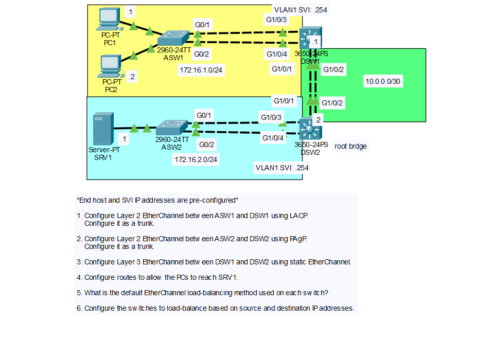

# Day 23 Lab: EtherChannel (LACP, PAgP, Static and Layer 3)

## Objective

Bundle redundant links into EtherChannels using three different methods: Layer 2 LACP (ASW1-DSW1), Layer 2 PAgP (ASW2-DSW2), and Layer 3 static (DSW1-DSW2). Configure static routes so the PCs can reach the server, check the default load-balancing method, and change it to use source and destination IP addresses.

## Topology



## Networks

| Network | Purpose | Devices |
|---------|---------|---------|
| 172.16.1.0/24 | VLAN 1 (ASW1 side) | PC1, PC2, ASW1, DSW1 SVI |
| 172.16.2.0/24 | VLAN 1 (ASW2 side) | SRV1, ASW2, DSW2 SVI |
| 10.0.0.0/30 | Point-to-point link between DSW1 and DSW2 | DSW1 `.1`, DSW2 `.2` |

The end host and SVI IP addresses were preconfigured.

## IP Addressing Table

| Device | Interface | IP Address | Subnet Mask |
|--------|-----------|------------|-------------|
| PC1 | NIC | 172.16.1.1 | 255.255.255.0 |
| PC2 | NIC | 172.16.1.2 | 255.255.255.0 |
| DSW1 | VLAN 1 SVI | 172.16.1.254 | 255.255.255.0 |
| DSW1 | Port-channel 2 | 10.0.0.1 | 255.255.255.252 |
| DSW2 | Port-channel 2 | 10.0.0.2 | 255.255.255.252 |
| DSW2 | VLAN 1 SVI | 172.16.2.254 | 255.255.255.0 |
| SRV1 | NIC | 172.16.2.1 | 255.255.255.0 |

## EtherChannel Summary

| Link | Member Interfaces | Type | Protocol | Port-channel |
|------|-------------------|------|----------|--------------|
| ASW1 - DSW1 | ASW1 G0/1-2, DSW1 G1/0/3-4 | Layer 2 (trunk) | LACP | Po1 on both |
| ASW2 - DSW2 | ASW2 G0/1-2, DSW2 G1/0/3-4 | Layer 2 (trunk) | PAgP | Po1 on both |
| DSW1 - DSW2 | DSW1 G1/0/1-2, DSW2 G1/0/1-2 | Layer 3 (routed) | Static (`on`) | Po2 on both |

The port-channel number only has meaning on the local switch, so the two ends do not have to use the same number.

## Steps Performed

1. **Configure Layer 2 EtherChannel with LACP (ASW1-DSW1)**
   Bundled ASW1 G0/1-2 and DSW1 G1/0/3-4 into Port-channel 1 using LACP and configured the port-channel as a trunk.

2. **Configure Layer 2 EtherChannel with PAgP (ASW2-DSW2)**
   Bundled ASW2 G0/1-2 and DSW2 G1/0/3-4 into Port-channel 1 using PAgP and configured the port-channel as a trunk.

3. **Configure Layer 3 EtherChannel with static mode (DSW1-DSW2)**
   Changed DSW1 G1/0/1-2 and DSW2 G1/0/1-2 to routed ports, bundled them into Port-channel 2 using mode `on`, and assigned the `10.0.0.0/30` addresses to the port-channels.

4. **Configure routes**
   Added static routes on DSW1 and DSW2 so each switch can reach the other's LAN.

5. **Check the default load-balancing method**
   Used `show etherchannel load-balance` on each switch to see the default method.

6. **Change the load-balancing method**
   Configured all switches to load-balance based on source and destination IP addresses.

## Key Commands Used

### Step 1: LACP (ASW1 and DSW1)

```
! ASW1
interface range g0/1 - 2
 channel-group 1 mode active
interface port-channel 1
 switchport mode trunk

! DSW1
interface range g1/0/3 - 4
 channel-group 1 mode active
interface port-channel 1
 switchport mode trunk
```

LACP modes are `active` (initiates negotiation) and `passive` (only responds). At least one side must be `active`.

### Step 2: PAgP (ASW2 and DSW2)

```
! ASW2
interface range g0/1 - 2
 channel-group 1 mode desirable
interface port-channel 1
 switchport mode trunk

! DSW2
interface range g1/0/3 - 4
 channel-group 1 mode desirable
interface port-channel 1
 switchport mode trunk
```

PAgP modes are `desirable` (initiates negotiation) and `auto` (only responds). At least one side must be `desirable`. PAgP is Cisco proprietary.

### Step 3: Layer 3 Static EtherChannel (DSW1 and DSW2)

```
! DSW1
interface range g1/0/1 - 2
 no switchport
 channel-group 2 mode on
interface port-channel 2
 no switchport
 ip address 10.0.0.1 255.255.255.252
 no shutdown

! DSW2
interface range g1/0/1 - 2
 no switchport
 channel-group 2 mode on
interface port-channel 2
 no switchport
 ip address 10.0.0.2 255.255.255.252
 no shutdown
```

Mode `on` forms the EtherChannel without any negotiation protocol, so both sides must be set to `on`. Mode `on` will not bundle with LACP or PAgP modes.

### Step 4: Static Routes

```
! DSW1
ip routing
ip route 172.16.2.0 255.255.255.0 10.0.0.2

! DSW2
ip routing
ip route 172.16.1.0 255.255.255.0 10.0.0.1
```

`ip routing` must be enabled on the multilayer switches for them to route between the SVIs and the routed port-channel.

### Step 5: Check the Load-Balancing Method

```
show etherchannel load-balance
```

### Step 6: Change the Load-Balancing Method

```
! ASW1, ASW2, DSW1, DSW2
configure terminal
port-channel load-balance src-dst-ip
```

### Verification Commands

```
show etherchannel summary
show interfaces trunk
show ip route
show etherchannel load-balance
```

## Verification

### EtherChannel Status


- On the Layer 2 EtherChannels (Po1), the port-channel flags are `SU` (Layer 2, in use) and the member ports are `P` (bundled in port-channel).
- On the Layer 3 EtherChannel (Po2 on DSW1 and DSW2), the port-channel flags are `RU` (Layer 3, in use) and the member ports are `P`.
- The protocol column shows LACP for ASW1-DSW1, PAgP for ASW2-DSW2, and `-` (none) for the static DSW1-DSW2 channel.

### Trunks


- `Port-channel 1` appears as a trunk on ASW1, DSW1, ASW2, and DSW2. The individual member interfaces do not appear separately.

### Routing


- DSW1 has a connected route for `172.16.1.0/24` and `10.0.0.0/30` and a static route for `172.16.2.0/24` through `10.0.0.2`.
- DSW2 has the matching connected routes and a static route for `172.16.1.0/24` through `10.0.0.1`.

### Connectivity


| Source | Destination | Result |
|--------|-------------|--------|
| PC1 | SRV1 (172.16.2.1) | Successful |
| PC2 | SRV1 (172.16.2.1) | Successful |
| SRV1 | PC1 (172.16.1.1) | Successful |

## Step 5: Default Load-Balancing Method


The default method depends on the switch model:

| Switch | Model | Default Method |
|--------|-------|----------------|
| ASW1, ASW2 | 2960-24TT | Source MAC (`src-mac`) |
| DSW1, DSW2 | 3650-24PS | Source and destination IP (`src-dst-ip`) |

Confirm these values with `show etherchannel load-balance` on each switch.

## Step 6: Load-Balancing Based on Source and Destination IP

After running `port-channel load-balance src-dst-ip` on all four switches, `show etherchannel load-balance` reports source XOR destination IP as the method.

Load-balancing decides which physical link in the bundle each frame uses. It is based on a hash of the chosen fields, so traffic between the same source and destination always uses the same link, while different flows are spread across the links. Using IP addresses gives a better spread than MAC addresses in this topology, because all traffic from the PCs to SRV1 passes through the routed link with the same MAC addresses on the frames.

## Skills Demonstrated

- Configuring Layer 2 EtherChannel with LACP and PAgP
- Configuring a Layer 3 EtherChannel with static mode
- Configuring port-channel interfaces as trunks and routed ports
- Configuring static routes on multilayer switches
- Checking and changing the EtherChannel load-balancing method
- Verification with `show etherchannel summary`, `show interfaces trunk`, and `show ip route`
