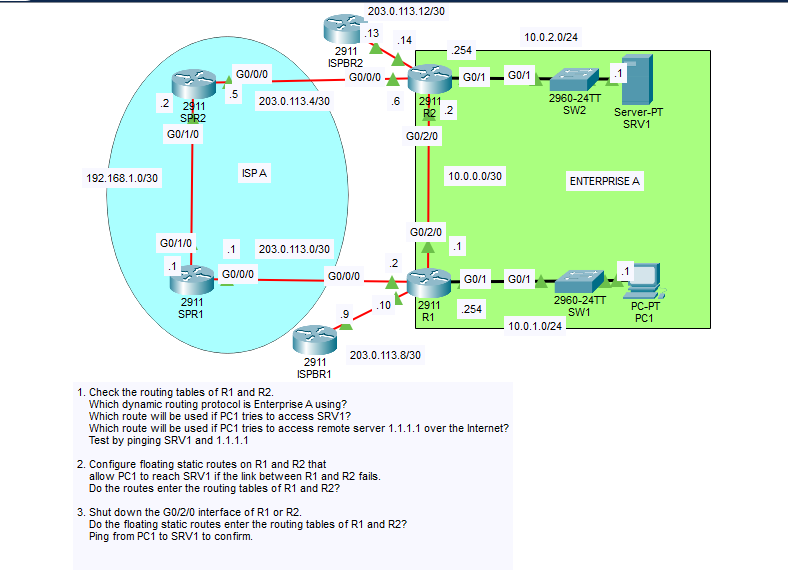

# Day 24 Lab: Floating Static Routes

## Objective

Examine the routing tables of two enterprise routers (R1 and R2), configure floating static routes that provide a backup path between the two LANs through the ISP, and test the failover by shutting down the direct link between R1 and R2.

## Topology



## Networks

| Network | Purpose |
|---------|---------|
| 10.0.1.0/24 | R1 LAN (PC1) |
| 10.0.2.0/24 | R2 LAN (SRV1) |
| 10.0.0.0/30 | Direct link between R1 and R2 (G0/2/0) |
| 203.0.113.0/30 | R1 - SPR1 (ISP A) |
| 203.0.113.4/30 | R2 - SPR2 (ISP A) |
| 203.0.113.8/30 | R1 - ISPBR1 |
| 203.0.113.12/30 | R2 - ISPBR2 |
| 192.168.1.0/30 | SPR1 - SPR2 (inside ISP A) |

## IP Addressing Table

| Device | Interface | IP Address | Subnet Mask |
|--------|-----------|------------|-------------|
| R1 | G0/1 | 10.0.1.254 | 255.255.255.0 |
| R1 | G0/2/0 | 10.0.0.1 | 255.255.255.252 |
| R1 | G0/0/0 | 203.0.113.2 | 255.255.255.252 |
| R1 | Link to ISPBR1 | 203.0.113.10 | 255.255.255.252 |
| R2 | G0/1 | 10.0.2.254 | 255.255.255.0 |
| R2 | G0/2/0 | 10.0.0.2 | 255.255.255.252 |
| R2 | G0/0/0 | 203.0.113.6 | 255.255.255.252 |
| R2 | Link to ISPBR2 | 203.0.113.14 | 255.255.255.252 |
| SPR1 | G0/0/0 | 203.0.113.1 | 255.255.255.252 |
| SPR1 | G0/1/0 | 192.168.1.1 | 255.255.255.252 |
| SPR2 | G0/0/0 | 203.0.113.5 | 255.255.255.252 |
| SPR2 | G0/1/0 | 192.168.1.2 | 255.255.255.252 |
| PC1 | NIC | 10.0.1.1 | 255.255.255.0 |
| SRV1 | NIC | 10.0.2.1 | 255.255.255.0 |

The default gateway of PC1 is R1 G0/1 (10.0.1.254) and the default gateway of SRV1 is R2 G0/1 (10.0.2.254). The router and host addresses were preconfigured.

## Steps Performed

1. **Check the routing tables of R1 and R2**
   Ran `show ip route` on both routers to identify the dynamic routing protocol and the routes used to reach SRV1 and the Internet (1.1.1.1). Tested with pings from PC1.

2. **Configure floating static routes**
   Configured a static route on each router to the other router's LAN through the ISP A path, with an administrative distance higher than the dynamic routing protocol's. Checked whether the routes entered the routing tables.

3. **Test failover**
   Shut down the G0/2/0 interface on R1 (or R2), checked whether the floating static routes entered the routing tables, and pinged from PC1 to SRV1.

## What Is a Floating Static Route?

A floating static route is a static route with a **higher administrative distance (AD)** than another route to the same destination. The router installs the route with the lowest AD, so the floating route stays out of the routing table while the primary route is working. If the primary route disappears, the floating route "floats" up into the routing table and takes over.

| Route Source | Default AD |
|--------------|------------|
| Connected | 0 |
| Static | 1 |
| EIGRP | 90 |
| OSPF | 110 |
| RIP | 120 |
| Floating static (this lab) | 130 |

An AD of 130 is higher than the default AD of OSPF, EIGRP, and RIP, so the floating static route is a backup no matter which of them Enterprise A runs.

## Key Commands Used

### Step 1: Verification

```
show ip route
show ip route 10.0.2.0
```

From PC1:

```
ping 10.0.2.1
ping 1.1.1.1
```

### Step 2: Floating Static Routes

```
! R1 - backup path to R2's LAN through SPR1 (ISP A)
configure terminal
ip route 10.0.2.0 255.255.255.0 203.0.113.1 130

! R2 - backup path to R1's LAN through SPR2 (ISP A)
configure terminal
ip route 10.0.1.0 255.255.255.0 203.0.113.5 130
```

The final number (`130`) is the administrative distance.

### Step 3: Failover Test

```
! R1 (or R2)
configure terminal
interface g0/2/0
 shutdown
```

Verify:

```
show ip route
show ip route static
```

From PC1:

```
ping 10.0.2.1
traceroute 10.0.2.1
```

To restore the link after the test:

```
interface g0/2/0
 no shutdown
```

## Step 1: Routing Tables and Path Selection


### Which dynamic routing protocol is Enterprise A using?

Enterprise A is using **`<protocol>`**, shown by the route code in `show ip route` (`O` = OSPF, `D` = EIGRP, `R` = RIP).

> **Fill in:** replace `<protocol>` with the protocol from your routing table.

### Which route is used when PC1 accesses SRV1?

PC1 sends the traffic to its gateway, R1. R1 uses the dynamic route to `10.0.2.0/24` learned from R2 across the direct link (`10.0.0.0/30` via G0/2/0), and R2 delivers it to SRV1. This is the shortest path and uses the direct link.

### Which route is used when PC1 accesses 1.1.1.1?

There is no specific route to 1.1.1.1, so R1 uses its **default route** (`0.0.0.0/0`, marked `S*` if static) toward the Internet.

> **Fill in:** the next hop of the default route from your `show ip route` output.

### Test results

| Test | Source | Destination | Result |
|------|--------|-------------|--------|
| 1 | PC1 | SRV1 (10.0.2.1) | Successful |
| 2 | PC1 | 1.1.1.1 | Successful |

## Step 2: Do the Floating Static Routes Enter the Routing Tables?


**No.** The dynamic route to the remote LAN has a lower administrative distance (for example, OSPF 110) than the floating static route (130). The router installs the route with the lowest AD, so the static route is not shown in `show ip route`. It remains in the running configuration, and you can see it with `show running-config | include ip route`.

## Step 3: Shut Down G0/2/0


**Do the floating static routes enter the routing tables? Yes.**

- Shutting down G0/2/0 on one router takes the direct link down on **both** ends, so both R1 and R2 lose their neighbor and the dynamic routes learned over that link are removed.
- With the dynamic routes gone, the floating static routes are now the best (and only) routes to the remote LANs, so they enter the routing tables and appear with `S` and `[130/0]` in `show ip route`.
- Traffic from PC1 to SRV1 now takes the backup path through ISP A: R1 -> SPR1 -> SPR2 -> R2.


| Test | Source | Destination | Result |
|------|--------|-------------|--------|
| 1 | PC1 | SRV1 (10.0.2.1) | Successful through the backup path (the first ping may time out while the tables update) |

When the link is restored with `no shutdown`, the dynamic routes return, and the floating static routes drop out of the tables again.

## Skills Demonstrated

- Reading routing tables and identifying the routing protocol, route codes, and administrative distance
- Understanding how the router selects between routes to the same destination
- Configuring floating static routes with a custom administrative distance
- Testing failover by shutting down an interface
- Verification with `show ip route`, `ping`, and `traceroute`
