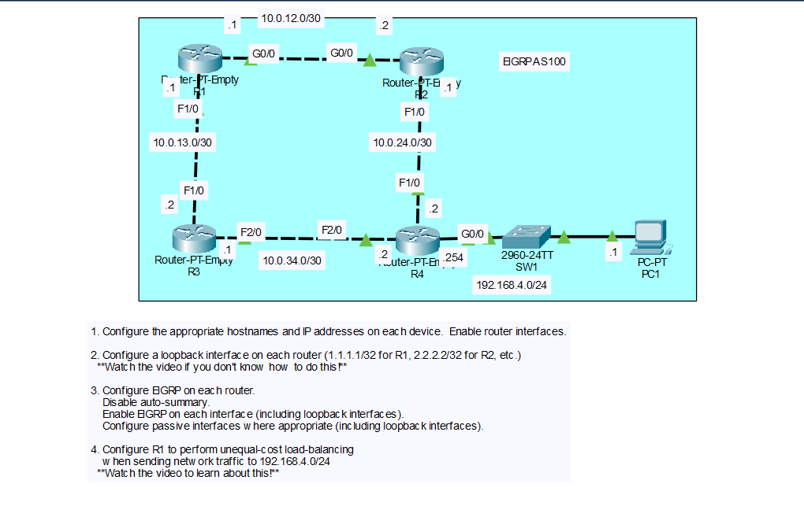

# Lab: EIGRP Configuration and Unequal-Cost Load Balancing

## Objective

Configure hostnames, IP addresses, and loopback interfaces on four routers, enable EIGRP (AS 100) with auto-summary disabled and passive interfaces where appropriate, and configure R1 to perform unequal-cost load balancing to the `192.168.4.0/24` network using `variance`.

## Topology



## Networks

| Network | Link |
|---------|------|
| 10.0.12.0/30 | R1 G0/0 - R2 G0/0 |
| 10.0.13.0/30 | R1 F1/0 - R3 F1/0 |
| 10.0.24.0/30 | R2 F1/0 - R4 F1/0 |
| 10.0.34.0/30 | R3 F2/0 - R4 F2/0 |
| 192.168.4.0/24 | R4 G0/0 - SW1 - PC1 |

## IP Addressing Table

| Device | Interface | IP Address | Subnet Mask |
|--------|-----------|------------|-------------|
| R1 | G0/0 | 10.0.12.1 | 255.255.255.252 |
| R1 | F1/0 | 10.0.13.1 | 255.255.255.252 |
| R1 | Loopback0 | 1.1.1.1 | 255.255.255.255 |
| R2 | G0/0 | 10.0.12.2 | 255.255.255.252 |
| R2 | F1/0 | 10.0.24.1 | 255.255.255.252 |
| R2 | Loopback0 | 2.2.2.2 | 255.255.255.255 |
| R3 | F1/0 | 10.0.13.2 | 255.255.255.252 |
| R3 | F2/0 | 10.0.34.1 | 255.255.255.252 |
| R3 | Loopback0 | 3.3.3.3 | 255.255.255.255 |
| R4 | F1/0 | 10.0.24.2 | 255.255.255.252 |
| R4 | F2/0 | 10.0.34.2 | 255.255.255.252 |
| R4 | G0/0 | 192.168.4.254 | 255.255.255.0 |
| R4 | Loopback0 | 4.4.4.4 | 255.255.255.255 |
| PC1 | NIC | 192.168.4.1 | 255.255.255.0 |

The default gateway of PC1 is R4 G0/0 (`192.168.4.254`).

## Steps Performed

1. **Configure hostnames and IP addresses**
   Set the hostname on each router, assigned the IP addresses from the table, and enabled each interface with `no shutdown`. Configured PC1 with its address and default gateway.

2. **Configure loopback interfaces**
   Created `Loopback0` on each router with a /32 address (`1.1.1.1` on R1, `2.2.2.2` on R2, `3.3.3.3` on R3, `4.4.4.4` on R4).

3. **Configure EIGRP**
   Enabled EIGRP AS 100 on each router, disabled auto-summary, and advertised every interface (including the loopbacks) with `network` commands. Made the loopback interfaces passive on all routers and the LAN interface (R4 G0/0) passive on R4.

4. **Configure unequal-cost load balancing on R1**
   Configured `variance` on R1 so that both paths to `192.168.4.0/24` (through R2 and through R3) are installed in the routing table.

## Key Commands Used

### Step 1 and 2: Hostnames, IP Addresses, and Loopbacks

```
! R1
enable
configure terminal
hostname R1
interface g0/0
 ip address 10.0.12.1 255.255.255.252
 no shutdown
interface f1/0
 ip address 10.0.13.1 255.255.255.252
 no shutdown
interface loopback0
 ip address 1.1.1.1 255.255.255.255

! R2
enable
configure terminal
hostname R2
interface g0/0
 ip address 10.0.12.2 255.255.255.252
 no shutdown
interface f1/0
 ip address 10.0.24.1 255.255.255.252
 no shutdown
interface loopback0
 ip address 2.2.2.2 255.255.255.255

! R3
enable
configure terminal
hostname R3
interface f1/0
 ip address 10.0.13.2 255.255.255.252
 no shutdown
interface f2/0
 ip address 10.0.34.1 255.255.255.252
 no shutdown
interface loopback0
 ip address 3.3.3.3 255.255.255.255

! R4
enable
configure terminal
hostname R4
interface f1/0
 ip address 10.0.24.2 255.255.255.252
 no shutdown
interface f2/0
 ip address 10.0.34.2 255.255.255.252
 no shutdown
interface g0/0
 ip address 192.168.4.254 255.255.255.0
 no shutdown
interface loopback0
 ip address 4.4.4.4 255.255.255.255
```

### Step 3: EIGRP

```
! R1
router eigrp 100
 no auto-summary
 network 10.0.12.0 0.0.0.3
 network 10.0.13.0 0.0.0.3
 network 1.1.1.1 0.0.0.0
 passive-interface loopback0

! R2
router eigrp 100
 no auto-summary
 network 10.0.12.0 0.0.0.3
 network 10.0.24.0 0.0.0.3
 network 2.2.2.2 0.0.0.0
 passive-interface loopback0

! R3
router eigrp 100
 no auto-summary
 network 10.0.13.0 0.0.0.3
 network 10.0.34.0 0.0.0.3
 network 3.3.3.3 0.0.0.0
 passive-interface loopback0

! R4
router eigrp 100
 no auto-summary
 network 10.0.24.0 0.0.0.3
 network 10.0.34.0 0.0.0.3
 network 192.168.4.0 0.0.0.255
 network 4.4.4.4 0.0.0.0
 passive-interface loopback0
 passive-interface g0/0
```

The `network` command uses a wildcard mask (the inverse of the subnet mask). A passive interface is still advertised in EIGRP, but the router does not send hellos or form neighbors on it. This is correct for the loopbacks and for R4's LAN interface, which has no EIGRP neighbors.

### Step 4: Unequal-Cost Load Balancing

```
! R1
router eigrp 100
 variance 2
```

### Verification Commands

```
show ip eigrp neighbors
show ip route eigrp
show ip protocols
show ip eigrp topology 192.168.4.0/24
show ip route 192.168.4.0
```

## Verification

### EIGRP Neighbors and Routes

- `show ip eigrp neighbors` on R1 lists two neighbors: R2 (`10.0.12.2`) and R3 (`10.0.13.2`). R2 and R3 each have two neighbors as well, and R4 has R2 and R3.
- `show ip route eigrp` lists the loopbacks and `/30` networks of the other routers as `D` routes, and the `192.168.4.0/24` network learned from R4.
- `show ip protocols` shows EIGRP AS 100, automatic summarization disabled, and the passive interfaces (`Loopback0` on every router, and `GigabitEthernet0/0` on R4).
- PC1 can ping the loopback addresses of all four routers.

## Step 4: How Unequal-Cost Load Balancing Works

R1 has two paths to `192.168.4.0/24`:

| Path | Route | Reported Distance (from the neighbor) | Feasible Distance (total from R1) |
|------|-------|---------------------------------------|-----------------------------------|
| Via R2 | R1 -> R2 -> R4 -> LAN | 28416 | 28672 |
| Via R3 | R1 -> R3 -> R4 -> LAN | 28416 | 30976 |

These values come from the EIGRP metric formula using the default interface values (GigabitEthernet: 1,000,000 kbps and 10 us delay; FastEthernet: 100,000 kbps and 100 us delay):

`metric = 256 x ( 10^7 / lowest bandwidth in kbps + total delay in tens of us )`

- **Via R2:** The lowest bandwidth is 100,000 kbps (the R2-R4 FastEthernet link). The total delay is 10 + 100 + 10 = 120 us, so the metric is 256 x (100 + 12) = **28672**.
- **Via R3:** The lowest bandwidth is 100,000 kbps. The total delay is 100 + 100 + 10 = 210 us, so the metric is 256 x (100 + 21) = **30976**.

Confirm these numbers with `show ip eigrp topology 192.168.4.0/24` and `show interfaces`, because the interface bandwidth and delay values in your lab determine the real metrics.

### Successor and Feasible Successor

- The path through R2 has the lowest feasible distance (28672), so R2 is the **successor** and the route is installed by default.
- The path through R3 has a reported distance of 28416, which is lower than the successor's feasible distance (28672). This meets the **feasibility condition**, so R3 is a **feasible successor**.

By default, EIGRP only installs the successor, so R1 only uses the path through R2.

### Variance

`variance` is a multiplier. EIGRP installs any feasible successor whose feasible distance is less than or equal to **variance x the best (successor) feasible distance**.

- With `variance 2`, the limit is 2 x 28672 = 57344.
- The path through R3 has a feasible distance of 30976, which is below 57344, so it is also installed.

With `variance 2`, `show ip route 192.168.4.0` on R1 lists both next hops (`10.0.12.2` and `10.0.13.2`). The router sends traffic over both paths in proportion to their metrics, so the better path (through R2) carries slightly more. A variance of 1 (the default) means equal-cost load balancing only.

## Skills Demonstrated

- Configuring hostnames, IP addresses, and loopback interfaces on routers
- Enabling EIGRP with `network` commands and wildcard masks
- Disabling auto-summary and configuring passive interfaces
- Understanding the EIGRP metric, successors, and feasible successors
- Configuring unequal-cost load balancing with `variance`
- Verification with `show ip eigrp neighbors`, `show ip route`, and `show ip protocols`
