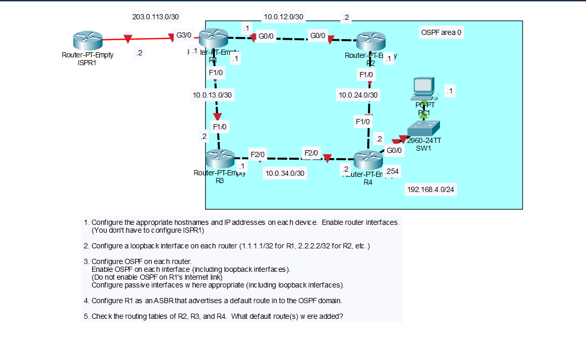

# Day 26 Lab: OSPF Part 1 - Single-Area OSPF and Default Route Advertisement

## Objective

Configure four routers with hostnames, IP addresses, and loopback interfaces, enable single-area OSPF (area 0) with passive interfaces where appropriate, and configure R1 as an ASBR that advertises a default route into the OSPF domain. Then check the routing tables of R2, R3, and R4 to see the default routes that were added.

## Topology



## Networks

| Network | Link |
|---------|------|
| 10.0.12.0/30 | R1 G0/0 - R2 G0/0 |
| 10.0.13.0/30 | R1 F1/0 - R3 F1/0 |
| 10.0.24.0/30 | R2 F1/0 - R4 F1/0 |
| 10.0.34.0/30 | R3 F2/0 - R4 F2/0 |
| 192.168.4.0/24 | R4 G0/0 - SW1 - PC1 |
| 203.0.113.0/30 | R1 G3/0 - ISPR1 (Internet link, not part of OSPF) |

## IP Addressing Table

| Device | Interface | IP Address | Subnet Mask |
|--------|-----------|------------|-------------|
| R1 | G0/0 | 10.0.12.1 | 255.255.255.252 |
| R1 | F1/0 | 10.0.13.1 | 255.255.255.252 |
| R1 | G3/0 | 203.0.113.1 | 255.255.255.252 |
| R1 | Loopback0 | 1.1.1.1 | 255.255.255.255 |
| R2 | G0/0 | 10.0.12.2 | 255.255.255.252 |
| R2 | F1/0 | 10.0.24.1 | 255.255.255.252 |
| R2 | Loopback0 | 2.2.2.2 | 255.255.255.255 |
| R3 | F1/0 | 10.0.13.2 | 255.255.255.252 |
| R3 | F2/0 | 10.0.34.1 | 255.255.255.252 |
| R3 | Loopback0 | 3.3.3.3 | 255.255.255.255 |
| R4 | F1/0 | 10.0.24.2 | 255.255.255.252 |
| R4 | F2/0 | 10.0.34.2 | 255.255.255.252 |
| R4 | G0/0 | 192.168.4.254 | 255.255.255.0 |
| R4 | Loopback0 | 4.4.4.4 | 255.255.255.255 |
| ISPR1 | (Internet link) | 203.0.113.2 | 255.255.255.252 |
| PC1 | NIC | 192.168.4.1 | 255.255.255.0 |

The default gateway of PC1 is R4 G0/0 (`192.168.4.254`). ISPR1 did not have to be configured in this lab.

## Steps Performed

1. **Configure hostnames and IP addresses**
   Set the hostname on each router, assigned the IP addresses from the table, and enabled each interface with `no shutdown`. Configured PC1 with its address and default gateway.

2. **Configure loopback interfaces**
   Created `Loopback0` on each router with a /32 address (`1.1.1.1` on R1, `2.2.2.2` on R2, `3.3.3.3` on R3, `4.4.4.4` on R4).

3. **Configure OSPF**
   Enabled OSPF (process 1, area 0) on every interface, including the loopbacks, but not on R1's Internet link (G3/0). Configured passive interfaces on the loopbacks and on R4's LAN interface.

4. **Configure R1 as an ASBR advertising a default route**
   Added a static default route on R1 toward ISPR1 and used `default-information originate` to advertise it into OSPF.

5. **Check the routing tables of R2, R3, and R4**
   Ran `show ip route` on each router to see which default routes were added.

## Key Commands Used

### Step 1 and 2: Hostnames, IP Addresses, and Loopbacks

```
! R1
enable
configure terminal
hostname R1
interface g0/0
 ip address 10.0.12.1 255.255.255.252
 no shutdown
interface f1/0
 ip address 10.0.13.1 255.255.255.252
 no shutdown
interface g3/0
 ip address 203.0.113.1 255.255.255.252
 no shutdown
interface loopback0
 ip address 1.1.1.1 255.255.255.255

! R2
enable
configure terminal
hostname R2
interface g0/0
 ip address 10.0.12.2 255.255.255.252
 no shutdown
interface f1/0
 ip address 10.0.24.1 255.255.255.252
 no shutdown
interface loopback0
 ip address 2.2.2.2 255.255.255.255

! R3
enable
configure terminal
hostname R3
interface f1/0
 ip address 10.0.13.2 255.255.255.252
 no shutdown
interface f2/0
 ip address 10.0.34.1 255.255.255.252
 no shutdown
interface loopback0
 ip address 3.3.3.3 255.255.255.255

! R4
enable
configure terminal
hostname R4
interface f1/0
 ip address 10.0.24.2 255.255.255.252
 no shutdown
interface f2/0
 ip address 10.0.34.2 255.255.255.252
 no shutdown
interface g0/0
 ip address 192.168.4.254 255.255.255.0
 no shutdown
interface loopback0
 ip address 4.4.4.4 255.255.255.255
```

### Step 3: OSPF

```
! R1
router ospf 1
 network 10.0.12.0 0.0.0.3 area 0
 network 10.0.13.0 0.0.0.3 area 0
 network 1.1.1.1 0.0.0.0 area 0
 passive-interface loopback0

! R2
router ospf 1
 network 10.0.12.0 0.0.0.3 area 0
 network 10.0.24.0 0.0.0.3 area 0
 network 2.2.2.2 0.0.0.0 area 0
 passive-interface loopback0

! R3
router ospf 1
 network 10.0.13.0 0.0.0.3 area 0
 network 10.0.34.0 0.0.0.3 area 0
 network 3.3.3.3 0.0.0.0 area 0
 passive-interface loopback0

! R4
router ospf 1
 network 10.0.24.0 0.0.0.3 area 0
 network 10.0.34.0 0.0.0.3 area 0
 network 192.168.4.0 0.0.0.255 area 0
 network 4.4.4.4 0.0.0.0 area 0
 passive-interface loopback0
 passive-interface g0/0
```

The `network` command uses a wildcard mask (the inverse of the subnet mask). R1's `203.0.113.0/30` network is left out of its `network` commands so OSPF is not enabled on the Internet link. A passive interface is still advertised, but the router does not send OSPF hellos or form neighbors on it.

### Step 4: ASBR and Default Route

```
! R1
ip route 0.0.0.0 0.0.0.0 203.0.113.2
router ospf 1
 default-information originate
```

### Verification Commands

```
show ip ospf neighbor
show ip route ospf
show ip protocols
show ip route
```

## Verification

### OSPF Neighbors and Routes

- `show ip ospf neighbor` on R1 lists two neighbors, R2 and R3, in the FULL state. R2 and R3 each have two neighbors, and R4 has R2 and R3. Router IDs are the loopback addresses.
- `show ip route ospf` lists the loopbacks and `/30` networks of the other routers as `O` routes, and the `192.168.4.0/24` network learned from R4. Loopbacks appear as `/32` host routes.
- `show ip protocols` shows OSPF process 1 with the passive interfaces (`Loopback0` on every router, and `GigabitEthernet0/0` on R4). R1 shows that it is an autonomous system boundary router.
- PC1 can ping the loopback addresses of all four routers.

## Step 4: R1 as an ASBR

An **ASBR** (Autonomous System Boundary Router) is a router that connects the OSPF domain to a different routing source. R1 is the ASBR here because its Internet link is outside OSPF, and it gets the default route from a static route instead.

- The static route `ip route 0.0.0.0 0.0.0.0 203.0.113.2` points all unknown traffic to ISPR1.
- `default-information originate` tells R1 to advertise its default route to the other OSPF routers as an external route (a Type 5 LSA).
- R1 must already have a default route in its routing table for this command to advertise anything, unless the `always` keyword is added.

R1's own routing table shows the default route as `S*` (static). The other routers receive it as an OSPF external route.

## Step 5: Default Routes in the Routing Tables

Each router learned the default route as `O*E2 0.0.0.0/0 [110/1]`:

- `O` means OSPF.
- `*` means it is a candidate default route.
- `E2` means OSPF external type 2. The metric (1) is the cost advertised by R1 and does not increase as the route passes through the network.
- `110` is the OSPF administrative distance.

| Router | Default Route(s) Added | Next Hop(s) |
|--------|------------------------|-------------|
| R2 | 1 | 10.0.12.1 (R1) through G0/0 |
| R3 | 1 | 10.0.13.1 (R1) through F1/0 |
| R4 | 2 (equal-cost) | 10.0.24.1 (R2) through F1/0 and 10.0.34.1 (R3) through F2/0 |

- **R2 and R3** are directly connected to R1, so each has one default route with R1 as the next hop.
- **R4** is not directly connected to R1. Both paths to R1 (through R2 and through R3) have the same total cost (1 + 1 = 2 with the default OSPF costs), so R4 installs both and load-balances between them.

Confirm these results with `show ip route` on each router.

## Skills Demonstrated

- Configuring hostnames, IP addresses, and loopback interfaces on routers
- Enabling single-area OSPF with `network` commands and wildcard masks
- Configuring passive interfaces
- Keeping an interface out of OSPF (the Internet link)
- Configuring an ASBR with a static default route and `default-information originate`
- Reading OSPF routing table codes (`O`, `O*E2`) and understanding equal-cost paths
- Verification with `show ip ospf neighbor`, `show ip route`, and `show ip protocols`
