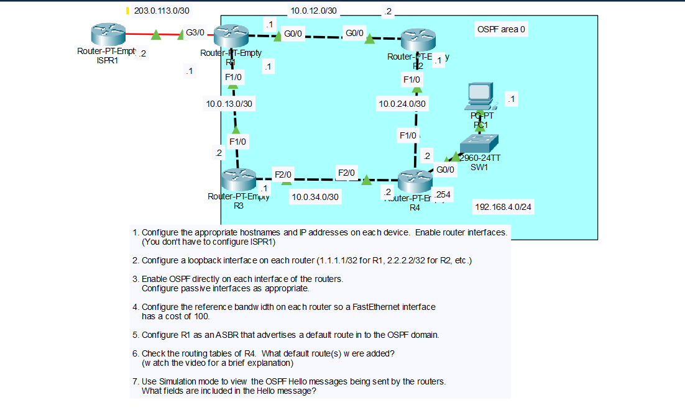

# Lab: OSPF Interface Configuration, Reference Bandwidth and Hello Messages

## Objective

Configure four routers with hostnames, IP addresses, and loopback interfaces, enable OSPF directly on each interface, change the OSPF reference bandwidth so a FastEthernet interface has a cost of 100, configure R1 as an ASBR that advertises a default route, and observe how the new costs change the default routes on R4. Then use Packet Tracer's Simulation mode to examine OSPF Hello messages.

## Topology



## Networks

| Network | Link |
|---------|------|
| 10.0.12.0/30 | R1 G0/0 - R2 G0/0 |
| 10.0.13.0/30 | R1 F1/0 - R3 F1/0 |
| 10.0.24.0/30 | R2 F1/0 - R4 F1/0 |
| 10.0.34.0/30 | R3 F2/0 - R4 F2/0 |
| 192.168.4.0/24 | R4 G0/0 - SW1 - PC1 |
| 203.0.113.0/30 | R1 G3/0 - ISPR1 (Internet link, not part of OSPF) |

## IP Addressing Table

| Device | Interface | IP Address | Subnet Mask |
|--------|-----------|------------|-------------|
| R1 | G0/0 | 10.0.12.1 | 255.255.255.252 |
| R1 | F1/0 | 10.0.13.1 | 255.255.255.252 |
| R1 | G3/0 | 203.0.113.1 | 255.255.255.252 |
| R1 | Loopback0 | 1.1.1.1 | 255.255.255.255 |
| R2 | G0/0 | 10.0.12.2 | 255.255.255.252 |
| R2 | F1/0 | 10.0.24.1 | 255.255.255.252 |
| R2 | Loopback0 | 2.2.2.2 | 255.255.255.255 |
| R3 | F1/0 | 10.0.13.2 | 255.255.255.252 |
| R3 | F2/0 | 10.0.34.1 | 255.255.255.252 |
| R3 | Loopback0 | 3.3.3.3 | 255.255.255.255 |
| R4 | F1/0 | 10.0.24.2 | 255.255.255.252 |
| R4 | F2/0 | 10.0.34.2 | 255.255.255.252 |
| R4 | G0/0 | 192.168.4.254 | 255.255.255.0 |
| R4 | Loopback0 | 4.4.4.4 | 255.255.255.255 |
| ISPR1 | (Internet link) | 203.0.113.2 | 255.255.255.252 |
| PC1 | NIC | 192.168.4.1 | 255.255.255.0 |

The default gateway of PC1 is R4 G0/0 (`192.168.4.254`). ISPR1 did not have to be configured in this lab.

## Steps Performed

1. **Configure hostnames and IP addresses**
   Set the hostname on each router, assigned the IP addresses from the table, and enabled each interface with `no shutdown`. Configured PC1 with its address and default gateway.

2. **Configure loopback interfaces**
   Created `Loopback0` on each router with a /32 address (`1.1.1.1` on R1, `2.2.2.2` on R2, `3.3.3.3` on R3, `4.4.4.4` on R4).

3. **Enable OSPF directly on each interface**
   Instead of using `network` commands, enabled OSPF process 1 in area 0 with `ip ospf 1 area 0` on each interface. Left R1's Internet link (G3/0) out of OSPF. Configured passive interfaces on the loopbacks and on R4's LAN interface.

4. **Configure the reference bandwidth**
   Set the OSPF reference bandwidth on every router so a FastEthernet interface has a cost of 100.

5. **Configure R1 as an ASBR advertising a default route**
   Added a static default route on R1 toward ISPR1 and used `default-information originate` to advertise it into OSPF.

6. **Check the routing table of R4**
   Ran `show ip route` on R4 to see which default routes were added.

7. **Examine OSPF Hello messages**
   Used Packet Tracer's Simulation mode to view the Hello messages sent by the routers and inspected the fields they contain.

## Key Commands Used

### Step 1 and 2: Hostnames, IP Addresses, and Loopbacks

```
! R1
enable
configure terminal
hostname R1
interface g0/0
 ip address 10.0.12.1 255.255.255.252
 no shutdown
interface f1/0
 ip address 10.0.13.1 255.255.255.252
 no shutdown
interface g3/0
 ip address 203.0.113.1 255.255.255.252
 no shutdown
interface loopback0
 ip address 1.1.1.1 255.255.255.255

! R2
enable
configure terminal
hostname R2
interface g0/0
 ip address 10.0.12.2 255.255.255.252
 no shutdown
interface f1/0
 ip address 10.0.24.1 255.255.255.252
 no shutdown
interface loopback0
 ip address 2.2.2.2 255.255.255.255

! R3
enable
configure terminal
hostname R3
interface f1/0
 ip address 10.0.13.2 255.255.255.252
 no shutdown
interface f2/0
 ip address 10.0.34.1 255.255.255.252
 no shutdown
interface loopback0
 ip address 3.3.3.3 255.255.255.255

! R4
enable
configure terminal
hostname R4
interface f1/0
 ip address 10.0.24.2 255.255.255.252
 no shutdown
interface f2/0
 ip address 10.0.34.2 255.255.255.252
 no shutdown
interface g0/0
 ip address 192.168.4.254 255.255.255.0
 no shutdown
interface loopback0
 ip address 4.4.4.4 255.255.255.255
```

### Step 3: Enable OSPF on Each Interface

```
! R1
interface g0/0
 ip ospf 1 area 0
interface f1/0
 ip ospf 1 area 0
interface loopback0
 ip ospf 1 area 0
router ospf 1
 passive-interface loopback0

! R2
interface g0/0
 ip ospf 1 area 0
interface f1/0
 ip ospf 1 area 0
interface loopback0
 ip ospf 1 area 0
router ospf 1
 passive-interface loopback0

! R3
interface f1/0
 ip ospf 1 area 0
interface f2/0
 ip ospf 1 area 0
interface loopback0
 ip ospf 1 area 0
router ospf 1
 passive-interface loopback0

! R4
interface f1/0
 ip ospf 1 area 0
interface f2/0
 ip ospf 1 area 0
interface g0/0
 ip ospf 1 area 0
interface loopback0
 ip ospf 1 area 0
router ospf 1
 passive-interface loopback0
 passive-interface g0/0
```

The `ip ospf 1 area 0` command enables OSPF on one interface and puts it in area 0. It creates the OSPF process if it does not exist yet, so no `network` command is needed. A passive interface is still advertised, but the router does not send OSPF hellos or form neighbors on it.

### Step 4: Reference Bandwidth

```
! R1, R2, R3, R4
router ospf 1
 auto-cost reference-bandwidth 10000
```

### Step 5: ASBR and Default Route

```
! R1
ip route 0.0.0.0 0.0.0.0 203.0.113.2
router ospf 1
 default-information originate
```

### Verification Commands

```
show ip ospf neighbor
show ip ospf interface brief
show ip route ospf
show ip route
show ip protocols
```

## Step 4: OSPF Reference Bandwidth

OSPF calculates the cost of an interface as:

`cost = reference bandwidth / interface bandwidth`

The default reference bandwidth is 100 Mbps, so FastEthernet, GigabitEthernet, and faster interfaces all end up with a cost of 1, and OSPF cannot tell them apart. Setting the reference bandwidth to `10000` (10 Gbps, entered in Mbps) gives these costs:

| Interface Type | Bandwidth | Default Cost | New Cost (reference 10000) |
|----------------|-----------|--------------|----------------------------|
| FastEthernet | 100 Mbps | 1 | 100 |
| GigabitEthernet | 1000 Mbps | 1 | 10 |

The reference bandwidth must be configured on **every** router in the OSPF domain, because each router calculates the cost of its own interfaces. If the values differ, the routers calculate costs on different scales and may pick poor paths. IOS prints a warning to remind you to change it on all routers.

## Step 5: R1 as an ASBR

An **ASBR** (Autonomous System Boundary Router) connects the OSPF domain to a different routing source. R1 is the ASBR because its Internet link is outside OSPF and its default route is a static route.

- The static route `ip route 0.0.0.0 0.0.0.0 203.0.113.2` points all unknown traffic to ISPR1.
- `default-information originate` tells R1 to advertise its default route to the other OSPF routers as an external route (a Type 5 LSA).
- R1 must already have a default route in its routing table for this command to advertise anything, unless the `always` keyword is added.

## Step 6: Default Route(s) on R4

R4 has **one** default route:

```
O*E2  0.0.0.0/0 [110/1] via 10.0.24.1, FastEthernet1/0
```

- `O*E2` means an OSPF external type 2 route that is a candidate default route.
- The next hop is `10.0.24.1`, which is R2.

### Why only one route?

R4 has two paths to R1 (the ASBR). For a type 2 external route, the metric (1) stays the same no matter how far the route travels, so R4 compares the **cost to reach the ASBR** to break the tie:

| Path | Calculation | Total Cost to R1 |
|------|-------------|------------------|
| Via R2 | R4 F1/0 (100) + R2 G0/0 (10) | 110 |
| Via R3 | R4 F2/0 (100) + R3 F1/0 (100) | 200 |

The path through R2 has the lower cost, so it is the only one installed. The path through R2 uses a GigabitEthernet link between R1 and R2 (cost 10), while the path through R3 uses two FastEthernet links (cost 100 each).

### Comparison with the default costs

Before the reference bandwidth was changed, every interface had a cost of 1, so both paths cost 2 and R4 installed **two equal-cost default routes** (through R2 and through R3). After the change, the faster Gigabit link makes the path through R2 clearly better, so only one route remains.

## Step 7: OSPF Hello Messages in Simulation Mode

Simulation mode was used to capture the OSPF Hello packets that each router sends out of its OSPF interfaces. Hellos are sent every 10 seconds on these links to the multicast address `224.0.0.5` (all OSPF routers). OSPF packets use IP protocol 89 and a TTL of 1, so they never leave the local link.

### Fields included in the Hello message

| Field | Purpose |
|-------|---------|
| Version | OSPF version (2 for IPv4) |
| Type | Packet type (1 = Hello) |
| Packet length | Length of the OSPF packet |
| Router ID | The sending router's ID |
| Area ID | The area of the sending interface (area 0 here) |
| Checksum | Error detection |
| Authentication type and data | Authentication, if configured |
| Network mask | Subnet mask of the sending interface |
| Hello interval | How often Hellos are sent (10 seconds on Ethernet) |
| Options | Optional capabilities supported by the router |
| Router priority | Used in DR/BDR elections |
| Dead interval | How long to wait before declaring a neighbor down (40 seconds on Ethernet) |
| Designated router (DR) | The current DR on the segment |
| Backup designated router (BDR) | The current BDR on the segment |
| Neighbors | Router IDs of neighbors the sender has seen on the segment |

The Area ID, Network mask, Hello interval, and Dead interval must match between two routers for them to become neighbors.

## Skills Demonstrated

- Configuring hostnames, IP addresses, and loopback interfaces on routers
- Enabling OSPF directly on interfaces with `ip ospf 1 area 0`
- Configuring passive interfaces
- Calculating OSPF cost and changing the reference bandwidth
- Configuring an ASBR with a static default route and `default-information originate`
- Understanding how the cost to the ASBR decides between type 2 external routes
- Inspecting OSPF Hello messages in Packet Tracer's Simulation mode
- Verification with `show ip ospf neighbor`, `show ip ospf interface brief`, and `show ip route`
