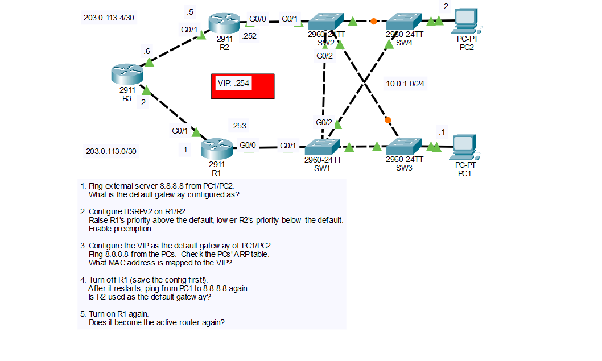

# Lab: First Hop Redundancy with HSRPv2

## Objective

Configure HSRP version 2 on two routers (R1 and R2) so the PCs have a redundant default gateway, use a virtual IP address (VIP) as the PCs' default gateway, and test failover and failback by turning R1 off and on.

## Topology



R3 acts as the Internet (ISP) router, and the external server `8.8.8.8` is reached through it. The four switches are interconnected with redundant links, and STP blocks some of them to prevent loops (the orange ports in the diagram).

## Networks

| Network | Link |
|---------|------|
| 10.0.1.0/24 | LAN: R1 and R2 G0/0, SW1-SW4, PC1, PC2 |
| 203.0.113.0/30 | R1 G0/1 - R3 |
| 203.0.113.4/30 | R2 G0/1 - R3 |

## IP Addressing Table

| Device | Interface | IP Address | Subnet Mask |
|--------|-----------|------------|-------------|
| R1 | G0/0 | 10.0.1.253 | 255.255.255.0 |
| R1 | G0/1 | 203.0.113.1 | 255.255.255.252 |
| R2 | G0/0 | 10.0.1.252 | 255.255.255.0 |
| R2 | G0/1 | 203.0.113.5 | 255.255.255.252 |
| R3 | Link to R1 | 203.0.113.2 | 255.255.255.252 |
| R3 | Link to R2 | 203.0.113.6 | 255.255.255.252 |
| PC1 | NIC | 10.0.1.1 | 255.255.255.0 |
| PC2 | NIC | 10.0.1.2 | 255.255.255.0 |
| HSRP VIP | Group 1 | 10.0.1.254 | 255.255.255.0 |

The routers and the PCs were preconfigured, apart from the HSRP configuration and the PCs' default gateway change in Step 3.

## Steps Performed

1. **Ping 8.8.8.8 from PC1 and PC2**
   Tested connectivity to the external server and checked how the default gateway was configured on each PC.

2. **Configure HSRPv2 on R1 and R2**
   Enabled HSRP version 2 on both routers with the VIP `10.0.1.254`. Raised R1's priority above the default (100) and lowered R2's below it, and enabled preemption.

3. **Use the VIP as the default gateway**
   Changed the default gateway of PC1 and PC2 to `10.0.1.254`, pinged 8.8.8.8, and checked the PCs' ARP tables.

4. **Test failover**
   Saved R1's configuration, turned R1 off, and pinged 8.8.8.8 from PC1 again.

5. **Test failback**
   Turned R1 back on and checked whether it became the active router again.

## Key Commands Used

### Step 2: HSRPv2 Configuration

```
! R1
interface g0/0
 standby version 2
 standby 1 ip 10.0.1.254
 standby 1 priority 110
 standby 1 preempt

! R2
interface g0/0
 standby version 2
 standby 1 ip 10.0.1.254
 standby 1 priority 90
 standby 1 preempt
```

- `standby version 2` uses HSRPv2, which must be set on both routers because the versions are not compatible.
- `standby 1 ip` sets the group number (1) and the virtual IP address.
- `standby 1 priority` sets the priority. The default is 100, and the router with the higher priority becomes the active router.
- `standby 1 preempt` allows a router with a higher priority to take over the active role from a lower-priority router. Without it, a router only becomes active when the current active router fails.

### Step 3: PC Configuration

Set the default gateway on PC1 and PC2 to `10.0.1.254` (Desktop > IP Configuration).

Check the ARP table from the PC's command prompt:

```
arp -a
```

### Step 4: Save R1 Before Turning It Off

```
! R1
copy running-config startup-config
```

### Verification Commands

```
show standby
show standby brief
```

From PC1 and PC2:

```
ping 8.8.8.8
tracert 8.8.8.8
arp -a
```

## Step 1: Original Default Gateway

PC1 and PC2 were configured with the real address of one router as their default gateway (R1's `10.0.1.253`), not a virtual address. This is a single point of failure: if that router goes down, the PCs lose access to the Internet even though R2 is still available.

> Confirm the gateway address on each PC under Desktop > IP Configuration.

## Step 2: HSRP Behavior

- R1 has priority 110 and R2 has priority 90, so **R1 becomes the active router** and R2 becomes the standby router.
- The active router answers ARP requests for the VIP and forwards the traffic sent to it. The standby router monitors the active router with Hello messages (every 3 seconds, with a hold time of 10 seconds by default) and takes over if they stop.
- HSRPv2 sends its Hello messages to the multicast address `224.0.0.102`.
- `show standby brief` on R1 shows the state `Active` for group 1 and R2 as the standby router. On R2 it shows `Standby`.

## Step 3: VIP as the Default Gateway

PC1 and PC2 can ping 8.8.8.8 through the VIP. Traffic goes to the active router (R1), then to R3.

### What MAC address is mapped to the VIP?

The PCs' ARP tables map `10.0.1.254` to the **HSRP virtual MAC address**, not the physical MAC address of R1 or R2:

| HSRP Version | Virtual MAC Format | Group 1 |
|--------------|--------------------|---------|
| HSRPv1 | `0000.0C07.ACxx` | `0000.0C07.AC01` |
| HSRPv2 | `0000.0C9F.Fxxx` | `0000.0C9F.F001` |

Because this lab uses HSRPv2 with group 1, the VIP maps to `0000.0C9F.F001`. The last digits are the group number in hexadecimal. The active router uses this MAC address, so the PCs do not need to update their ARP tables when the active router changes.

## Step 4: Turn Off R1

After R1 is turned off, the standby router (R2) stops receiving Hellos from R1. When the hold time expires, R2 becomes the active router.

**Is R2 used as the default gateway? Yes.**

- PC1 can still ping 8.8.8.8, although one or two pings may time out while R2 takes over.
- The PCs do not change anything, because their default gateway is still the VIP `10.0.1.254` and it maps to the same virtual MAC address.
- `tracert 8.8.8.8` now shows `10.0.1.252` (R2) as the first hop, where it used to show `10.0.1.253` (R1).
- `show standby brief` on R2 shows the state `Active`.

## Step 5: Turn R1 On Again

**Does R1 become the active router again? Yes.**

R1 loads its saved configuration, which is why it had to be saved before it was turned off. It then sees that R2 is the active router, but R1 has a higher priority (110 versus 90) and preemption is enabled, so R1 takes the active role back. R2 returns to the standby state, and traffic flows through R1 again.

If preemption were not enabled on R1, it would stay in the standby state after booting, and R2 would remain active until it failed.

## Skills Demonstrated

- Understanding first hop redundancy and the single point of failure of a default gateway
- Configuring HSRPv2 with a virtual IP, priority, and preemption
- Using a virtual IP as the default gateway for hosts
- Identifying the HSRP virtual MAC address in a host's ARP table
- Testing HSRP failover and failback
- Verification with `show standby`, `ping`, `tracert`, and `arp -a`
