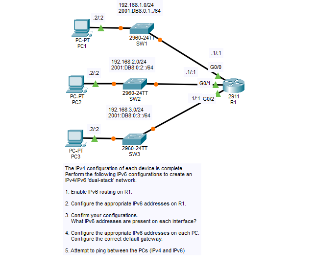

# Lab: IPv6 Dual-Stack Configuration

## Objective

Starting from a fully configured IPv4 network, add IPv6 to a router (R1) and three PCs to create a dual-stack network, where every device runs IPv4 and IPv6 at the same time. Enable IPv6 routing on R1, configure global unicast addresses, confirm the interface addresses, configure the PCs with an IPv6 default gateway, and test connectivity over both protocols.

## Topology



## Networks

| LAN | IPv4 Network | IPv6 Network | R1 Interface | Switch | PC |
|-----|--------------|--------------|--------------|--------|----|
| 1 | 192.168.1.0/24 | 2001:DB8:0:1::/64 | G0/0 | SW1 | PC1 |
| 2 | 192.168.2.0/24 | 2001:DB8:0:2::/64 | G0/1 | SW2 | PC2 |
| 3 | 192.168.3.0/24 | 2001:DB8:0:3::/64 | G0/2 | SW3 | PC3 |

The IPv4 configuration of each device was already complete. The `.1` and `:1` interface IDs belong to R1, and the `.2` and `:2` interface IDs belong to the PCs.

## Addressing Table

| Device | Interface | IPv4 Address | IPv4 Mask | IPv6 Address / Prefix |
|--------|-----------|--------------|-----------|-----------------------|
| R1 | G0/0 | 192.168.1.1 | 255.255.255.0 | 2001:DB8:0:1::1/64 |
| R1 | G0/1 | 192.168.2.1 | 255.255.255.0 | 2001:DB8:0:2::1/64 |
| R1 | G0/2 | 192.168.3.1 | 255.255.255.0 | 2001:DB8:0:3::1/64 |
| PC1 | NIC | 192.168.1.2 | 255.255.255.0 | 2001:DB8:0:1::2/64 |
| PC2 | NIC | 192.168.2.2 | 255.255.255.0 | 2001:DB8:0:2::2/64 |
| PC3 | NIC | 192.168.3.2 | 255.255.255.0 | 2001:DB8:0:3::2/64 |

| Device | IPv4 Default Gateway | IPv6 Default Gateway |
|--------|----------------------|----------------------|
| PC1 | 192.168.1.1 | 2001:DB8:0:1::1 |
| PC2 | 192.168.2.1 | 2001:DB8:0:2::1 |
| PC3 | 192.168.3.1 | 2001:DB8:0:3::1 |

## Steps Performed

1. **Enable IPv6 routing on R1**
   Enabled IPv6 unicast routing so R1 can forward IPv6 packets between its interfaces.

2. **Configure the IPv6 addresses on R1**
   Added a global unicast IPv6 address to each of R1's three LAN interfaces, keeping the existing IPv4 addresses.

3. **Confirm the configuration**
   Checked the IPv6 addresses present on each interface.

4. **Configure the PCs**
   Configured the IPv6 address and default gateway on PC1, PC2, and PC3.

5. **Test connectivity**
   Pinged between the PCs using both IPv4 and IPv6.

## Key Commands Used

### Steps 1 and 2: R1 Configuration

```
enable
configure terminal

ipv6 unicast-routing

interface g0/0
 ipv6 address 2001:db8:0:1::1/64
interface g0/1
 ipv6 address 2001:db8:0:2::1/64
interface g0/2
 ipv6 address 2001:db8:0:3::1/64

end
copy running-config startup-config
```

- `ipv6 unicast-routing` is a global command that turns the router into an IPv6 router. Without it, R1 can have IPv6 addresses and talk on its own links, but it will not forward IPv6 traffic between networks.
- The interfaces keep their IPv4 addresses. Adding an IPv6 address does not replace them, and that is what makes the network dual-stack.

### Step 3: Verification

```
show ipv6 interface brief
show ipv6 interface g0/0
show ipv6 route
```

### Step 4: PC Configuration

On each PC, open Desktop > IP Configuration and set the IPv6 configuration to static.

| PC | IPv6 Address | Prefix | IPv6 Default Gateway |
|----|--------------|--------|----------------------|
| PC1 | 2001:DB8:0:1::2 | 64 | 2001:DB8:0:1::1 |
| PC2 | 2001:DB8:0:2::2 | 64 | 2001:DB8:0:2::1 |
| PC3 | 2001:DB8:0:3::2 | 64 | 2001:DB8:0:3::1 |

### Step 5: Connectivity Tests

From PC1 (command prompt):

```
ping 192.168.2.2
ping 192.168.3.2
ping 2001:db8:0:2::2
ping 2001:db8:0:3::2
```

## Step 3: IPv6 Addresses on Each Interface

Each of R1's interfaces has **two unicast IPv6 addresses**:

| Address Type | Example (G0/0) | How It Is Created |
|--------------|----------------|-------------------|
| Global unicast | `2001:DB8:0:1::1` | Configured manually with the `ipv6 address` command |
| Link-local | `FE80::...` | Generated automatically as soon as IPv6 is enabled on the interface. By default it is built from the interface's MAC address using EUI-64 |

`show ipv6 interface brief` lists both addresses for each interface, so each of G0/0, G0/1, and G0/2 shows a `FE80::` address and its `2001:DB8:0:x::1` address.

### Link-local addresses

- A link-local address is only valid on the local link and is not routed. IPv6 uses it for neighbor discovery and for routing protocol messages.
- It is common for each interface to have a different link-local address, because the MAC address of each interface is different.

### Multicast groups

`show ipv6 interface g0/0` also lists the multicast groups the interface has joined:

- `FF02::1` (all nodes)
- `FF02::2` (all routers), joined once `ipv6 unicast-routing` is enabled
- Solicited-node multicast addresses (`FF02::1:FFxx:xxxx`), one for each unicast address, which are used for neighbor discovery

## Step 5: Connectivity Results

| Test | Source | Destination | Protocol | Result |
|------|--------|-------------|----------|--------|
| 1 | PC1 | PC2 (192.168.2.2) | IPv4 | Successful |
| 2 | PC1 | PC3 (192.168.3.2) | IPv4 | Successful |
| 3 | PC1 | PC2 (2001:DB8:0:2::2) | IPv6 | Successful |
| 4 | PC1 | PC3 (2001:DB8:0:3::2) | IPv6 | Successful |
| 5 | PC2 | PC3 | IPv4 and IPv6 | Successful |

All pings succeed over both IPv4 and IPv6. The first ping may time out while the devices resolve each other's MAC addresses, which IPv4 does with ARP and IPv6 does with **Neighbor Discovery (NDP)**. After that, `show ipv6 neighbors` on R1 lists the PCs' addresses, and the PCs' IPv6 default gateway is R1's global unicast address.

The PCs reach each other through R1, which routes between the three IPv6 networks, in the same way it already routes between the three IPv4 networks.

## Skills Demonstrated

- Understanding dual-stack networks (IPv4 and IPv6 running together)
- Enabling IPv6 routing with `ipv6 unicast-routing`
- Configuring IPv6 global unicast addresses on router interfaces and PCs
- Recognizing link-local addresses and multicast groups on an interface
- Configuring an IPv6 default gateway on hosts
- Verification with `show ipv6 interface brief`, `show ipv6 route`, and `ping`
