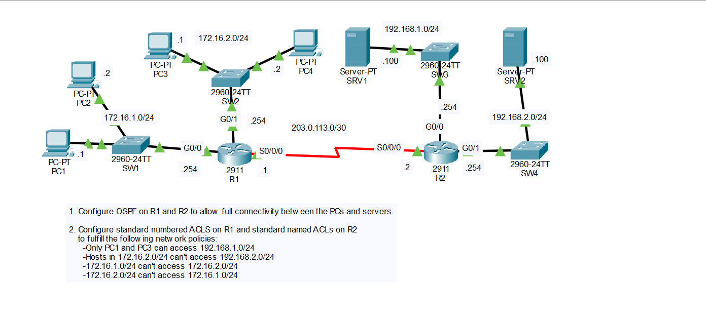

# Day 34 Lab: Standard ACLs (Numbered and Named)

## Objective

Configure OSPF on two routers to give full connectivity between four PCs and two servers, then use standard numbered ACLs on R1 and standard named ACLs on R2 to enforce four network access policies.

## Topology



## Networks

| Network | Link |
|---------|------|
| 172.16.1.0/24 | R1 G0/0 - SW1 - PC1, PC2 |
| 172.16.2.0/24 | R1 G0/1 - SW2 - PC3, PC4 |
| 203.0.113.0/30 | R1 S0/0/0 - R2 S0/0/0 (serial link) |
| 192.168.1.0/24 | R2 G0/0 - SW3 - SRV1 |
| 192.168.2.0/24 | R2 G0/1 - SW4 - SRV2 |

## IP Addressing Table

| Device | Interface | IP Address | Subnet Mask |
|--------|-----------|------------|-------------|
| R1 | G0/0 | 172.16.1.254 | 255.255.255.0 |
| R1 | G0/1 | 172.16.2.254 | 255.255.255.0 |
| R1 | S0/0/0 | 203.0.113.1 | 255.255.255.252 |
| R2 | S0/0/0 | 203.0.113.2 | 255.255.255.252 |
| R2 | G0/0 | 192.168.1.254 | 255.255.255.0 |
| R2 | G0/1 | 192.168.2.254 | 255.255.255.0 |
| PC1 | NIC | 172.16.1.1 | 255.255.255.0 |
| PC2 | NIC | 172.16.1.2 | 255.255.255.0 |
| PC3 | NIC | 172.16.2.1 | 255.255.255.0 |
| PC4 | NIC | 172.16.2.2 | 255.255.255.0 |
| SRV1 | NIC | 192.168.1.100 | 255.255.255.0 |
| SRV2 | NIC | 192.168.2.100 | 255.255.255.0 |

The default gateway of each host is the router interface on its LAN (`.254`).

## Network Policies

| # | Policy |
|---|--------|
| 1 | Only PC1 and PC3 can access 192.168.1.0/24 |
| 2 | Hosts in 172.16.2.0/24 cannot access 192.168.2.0/24 |
| 3 | 172.16.1.0/24 cannot access 172.16.2.0/24 |
| 4 | 172.16.2.0/24 cannot access 172.16.1.0/24 |

## Steps Performed

1. **Configure OSPF on R1 and R2**
   Enabled OSPF (process 1, area 0) on all interfaces of both routers and made the LAN interfaces passive, giving full connectivity between the PCs and servers. Confirmed this with ping before adding any ACLs.

2. **Configure standard numbered ACLs on R1**
   Created two numbered standard ACLs on R1 to implement policies 3 and 4 and applied them outbound on R1's LAN interfaces.

3. **Configure standard named ACLs on R2**
   Created two named standard ACLs on R2 to implement policies 1 and 2 and applied them outbound on R2's LAN interfaces.

4. **Test the policies**
   Pinged between the PCs and servers to confirm that each policy is enforced and that all other traffic still works.

## Key Commands Used

### Step 1: OSPF

```
! R1
router ospf 1
 network 172.16.1.0 0.0.0.255 area 0
 network 172.16.2.0 0.0.0.255 area 0
 network 203.0.113.0 0.0.0.3 area 0
 passive-interface g0/0
 passive-interface g0/1

! R2
router ospf 1
 network 192.168.1.0 0.0.0.255 area 0
 network 192.168.2.0 0.0.0.255 area 0
 network 203.0.113.0 0.0.0.3 area 0
 passive-interface g0/0
 passive-interface g0/1
```

The `network` command uses a wildcard mask (the inverse of the subnet mask). The LAN interfaces are passive because no OSPF neighbors exist on them, but their networks are still advertised.

### Step 2: Standard Numbered ACLs on R1

```
! Policy 3: 172.16.1.0/24 cannot access 172.16.2.0/24
access-list 1 deny 172.16.1.0 0.0.0.255
access-list 1 permit any
interface g0/1
 ip access-group 1 out

! Policy 4: 172.16.2.0/24 cannot access 172.16.1.0/24
access-list 2 deny 172.16.2.0 0.0.0.255
access-list 2 permit any
interface g0/0
 ip access-group 2 out
```

### Step 3: Standard Named ACLs on R2

```
! Policy 1: only PC1 and PC3 can access 192.168.1.0/24
ip access-list standard SRV1_ACCESS
 permit host 172.16.1.1
 permit host 172.16.2.1
interface g0/0
 ip access-group SRV1_ACCESS out

! Policy 2: 172.16.2.0/24 cannot access 192.168.2.0/24
ip access-list standard BLOCK_LAN2
 deny 172.16.2.0 0.0.0.255
 permit any
interface g0/1
 ip access-group BLOCK_LAN2 out
```

### Verification Commands

```
show ip ospf neighbor
show ip route ospf
show access-lists
show ip interface g0/0
```

## How Standard ACLs Work

- A standard ACL filters only on the **source IP address**. It cannot match the destination, the protocol, or the port.
- Numbered standard ACLs use the numbers 1-99 (and 1300-1999). Named ACLs use a descriptive name instead.
- The router checks the entries from top to bottom and stops at the first match.
- Every ACL ends with an **implicit deny any**, so traffic that matches no entry is dropped. This is why `permit any` is added at the end of the "block" ACLs, and why the policy 1 ACL needs no `deny` entry.
- A wildcard mask is used instead of a subnet mask (`0.0.0.255` matches a whole /24, and `host x.x.x.x` matches a single address).

### ACL Placement

Because a standard ACL can only match the source, it is placed **as close to the destination as possible**. If it were placed near the source, it would block that source from reaching every other destination too.

| Policy | Destination | ACL Placed On | Direction |
|--------|-------------|---------------|-----------|
| 1 (only PC1 and PC3 to 192.168.1.0/24) | 192.168.1.0/24 | R2 G0/0 | Out |
| 2 (172.16.2.0/24 to 192.168.2.0/24) | 192.168.2.0/24 | R2 G0/1 | Out |
| 3 (172.16.1.0/24 to 172.16.2.0/24) | 172.16.2.0/24 | R1 G0/1 | Out |
| 4 (172.16.2.0/24 to 172.16.1.0/24) | 172.16.1.0/24 | R1 G0/0 | Out |

An outbound ACL checks packets as they leave the interface toward the destination LAN. It does not filter traffic that the router itself generates, such as OSPF messages, and traffic returning from the servers is not affected because its source is a server address that is permitted by the ACLs.

## Verification

### Expected Connectivity Results

| Source | Destination | Result | Reason |
|--------|-------------|--------|--------|
| PC1 | SRV1 | Success | PC1 is permitted by SRV1_ACCESS |
| PC3 | SRV1 | Success | PC3 is permitted by SRV1_ACCESS |
| PC2 | SRV1 | Blocked | Not in SRV1_ACCESS (implicit deny) |
| PC4 | SRV1 | Blocked | Not in SRV1_ACCESS (implicit deny) |
| PC1 | SRV2 | Success | Only 172.16.2.0/24 is blocked from SRV2 |
| PC2 | SRV2 | Success | Only 172.16.2.0/24 is blocked from SRV2 |
| PC3 | SRV2 | Blocked | BLOCK_LAN2 denies 172.16.2.0/24 |
| PC4 | SRV2 | Blocked | BLOCK_LAN2 denies 172.16.2.0/24 |
| PC1 | PC3 | Blocked | ACL 1 denies 172.16.1.0/24 to 172.16.2.0/24 |
| PC2 | PC4 | Blocked | ACL 1 denies 172.16.1.0/24 to 172.16.2.0/24 |
| PC3 | PC1 | Blocked | ACL 2 denies 172.16.2.0/24 to 172.16.1.0/24 |
| PC4 | PC2 | Blocked | ACL 2 denies 172.16.2.0/24 to 172.16.1.0/24 |
| PC1 | PC2 | Success | Same LAN, not routed |
| PC3 | PC4 | Success | Same LAN, not routed |

- A blocked ping returns "Destination host unreachable" from the router that applied the ACL.
- `show access-lists` lists each ACL with match counters, which increase as the blocked and permitted packets are checked.
- `show ip interface g0/0` shows which ACL is applied to the interface and in which direction.

## Skills Demonstrated

- Configuring OSPF with passive interfaces
- Writing standard numbered and standard named ACLs
- Using wildcard masks and the `host` keyword
- Applying ACLs to interfaces in the correct direction
- Placing standard ACLs close to the destination
- Understanding the implicit deny and top-down ACL processing
- Verification with `show access-lists`, `show ip interface`, and `ping`
