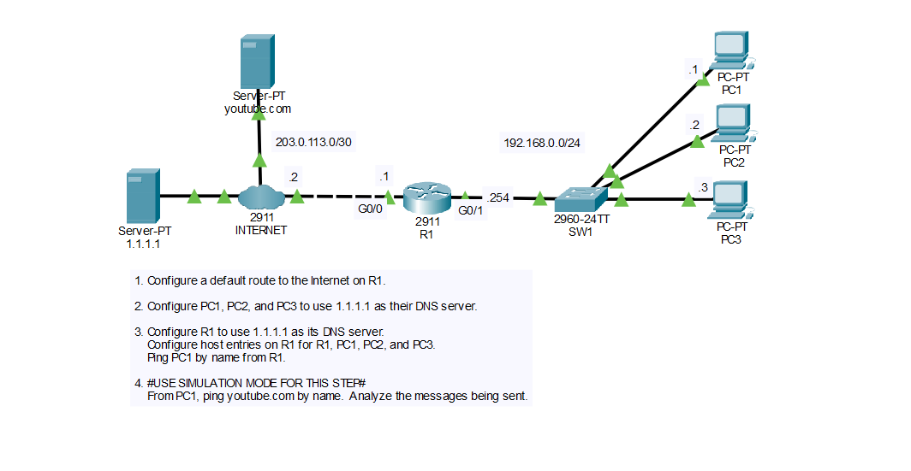

# Lab: DNS Configuration and Name Resolution

## Objective

Configure a default route to the Internet on R1, point the PCs and R1 at a DNS server (`1.1.1.1`), create local host entries on R1, and use Packet Tracer's Simulation mode to analyze the messages sent when a PC resolves a domain name and pings `youtube.com`.

## Topology



## Networks

| Network | Link |
|---------|------|
| 192.168.0.0/24 | R1 G0/1 - SW1 - PC1, PC2, PC3 |
| 203.0.113.0/30 | R1 G0/0 - INTERNET router |

The INTERNET router connects to the DNS server (`1.1.1.1`) and the `youtube.com` web server.

## IP Addressing Table

| Device | Interface | IP Address | Subnet Mask | Default Gateway |
|--------|-----------|------------|-------------|-----------------|
| R1 | G0/1 | 192.168.0.254 | 255.255.255.0 | N/A |
| R1 | G0/0 | 203.0.113.1 | 255.255.255.252 | N/A |
| INTERNET | (link to R1) | 203.0.113.2 | 255.255.255.252 | N/A |
| PC1 | NIC | 192.168.0.1 | 255.255.255.0 | 192.168.0.254 |
| PC2 | NIC | 192.168.0.2 | 255.255.255.0 | 192.168.0.254 |
| PC3 | NIC | 192.168.0.3 | 255.255.255.0 | 192.168.0.254 |
| DNS Server | NIC | 1.1.1.1 | | |

## Steps Performed

1. **Configure a default route on R1**
   Added a default route toward the INTERNET router so R1 can forward traffic to the DNS server and to `youtube.com`.

2. **Configure the DNS server on the PCs**
   Set `1.1.1.1` as the DNS server on PC1, PC2, and PC3.

3. **Configure DNS on R1**
   Configured R1 to use `1.1.1.1` as its DNS server, created local host entries for R1, PC1, PC2, and PC3, and pinged PC1 by name from R1.

4. **Analyze DNS messages in Simulation mode**
   Used Simulation mode to capture the messages sent when PC1 pings `youtube.com` by name.

## Key Commands Used

### Step 1: Default Route

```
! R1
enable
configure terminal
ip route 0.0.0.0 0.0.0.0 203.0.113.2
```

The default route (`0.0.0.0/0`) sends all traffic with no more specific route to the INTERNET router at `203.0.113.2`.

### Step 2: PC DNS Configuration

On each PC, open Desktop > IP Configuration and enter `1.1.1.1` in the **DNS Server** field.

### Step 3: R1 DNS Configuration

```
! R1
configure terminal
ip name-server 1.1.1.1
ip domain-lookup

ip host R1 192.168.0.254
ip host PC1 192.168.0.1
ip host PC2 192.168.0.2
ip host PC3 192.168.0.3
end
```

- `ip name-server` sets the DNS server that R1 queries for names it cannot resolve locally.
- `ip domain-lookup` enables DNS name resolution on the router. It is on by default, and it must not be turned off in this lab.
- `ip host <name> <address>` creates a static entry in R1's local host table. R1 checks this table first, before it asks the DNS server.

Test by name from R1:

```
ping PC1
```

### Verification Commands

```
show hosts
show ip route
ping 1.1.1.1
ping youtube.com
```

From a PC command prompt:

```
ping youtube.com
nslookup youtube.com
```

## Step 3: Name Resolution on R1

`show hosts` lists the configured name server, the static host entries (marked `perm`), and any names learned from DNS (marked `temp`).

When `ping PC1` is entered, R1 looks in its local host table first and finds `PC1 = 192.168.0.1`, so no DNS query is sent. The ping to PC1 succeeds using the name.

## Step 4: DNS Messages in Simulation Mode

When PC1 pings `youtube.com`, PC1 does not know the IP address of `youtube.com`, so it resolves the name first. The events appear in this order in Simulation mode:

| # | Message | From | To | Purpose |
|---|---------|------|----|---------|
| 1 | ARP request | PC1 | Broadcast | PC1 needs the MAC address of its default gateway (R1 `192.168.0.254`), because the DNS server (`1.1.1.1`) is on a different network |
| 2 | ARP reply | R1 | PC1 | R1 gives PC1 its MAC address |
| 3 | DNS query | PC1 | DNS server (1.1.1.1) | PC1 asks for the IP address of `youtube.com`. The packet is routed through R1 and the INTERNET router |
| 4 | DNS reply | DNS server | PC1 | The server returns the IP address of `youtube.com` |
| 5 | ICMP echo request | PC1 | youtube.com | PC1 now pings the IP address it learned |
| 6 | ICMP echo reply | youtube.com | PC1 | The server answers the ping |

The first routers on the path may also need to send their own ARP messages to find the next hop's MAC address (for example, R1 resolving `203.0.113.2`). ARP is only needed on the first packets, and the result is cached afterwards.

### Details of the DNS messages

- **Transport:** DNS uses **UDP port 53**. The query is sent from a random (ephemeral) source port to destination port 53 on the DNS server.
- **Query:** Contains a transaction ID, flags (a standard query with recursion desired), and a question section with the name `youtube.com`, the record type `A` (an IPv4 address), and the class `IN` (Internet).
- **Reply:** Contains the same transaction ID, flags (a response, with recursion available), the original question, and an answer section with the name, type `A`, class `IN`, TTL, and the IPv4 address of `youtube.com`.
- **Addresses:** The query's source IP is PC1 (`192.168.0.1`) and the destination IP is `1.1.1.1`. In the reply, these are swapped.
- **Caching:** PC1 caches the result, so a second ping to `youtube.com` skips the ARP and DNS steps and starts directly with the ICMP echo request.

### Why DNS comes before the ping

IP packets are addressed by IP address, not by name. The ping command first has to turn `youtube.com` into an IP address, and DNS is the system that provides this translation.

## Skills Demonstrated

- Configuring a default route on a router
- Configuring DNS servers on hosts and on a router (`ip name-server`)
- Creating static host entries on a router (`ip host`)
- Understanding the order of name resolution (local host table, then DNS server)
- Analyzing ARP, DNS, and ICMP messages in Packet Tracer's Simulation mode
- Verification with `show hosts`, `ping`, and `nslookup`
